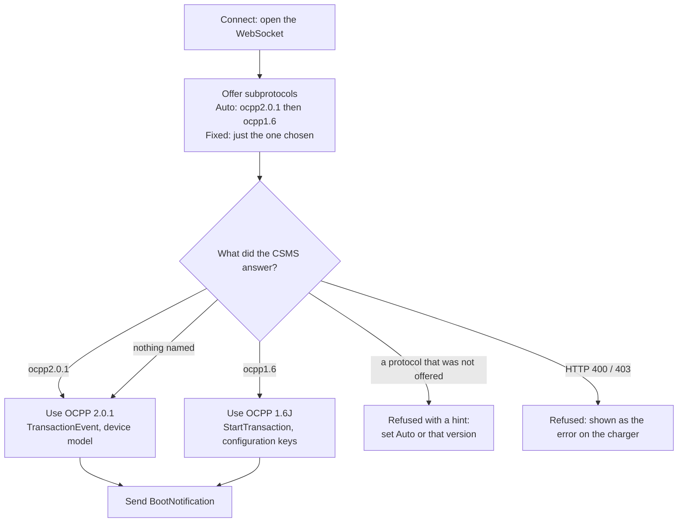
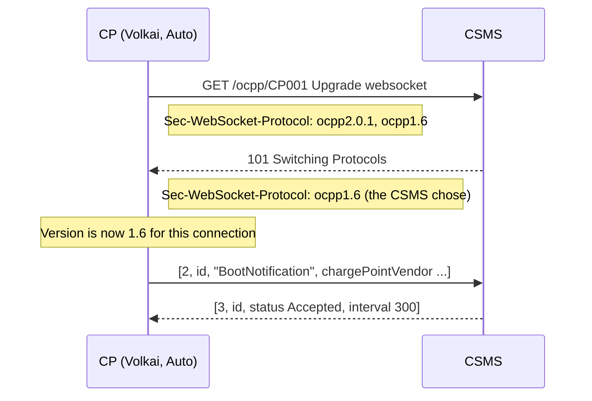
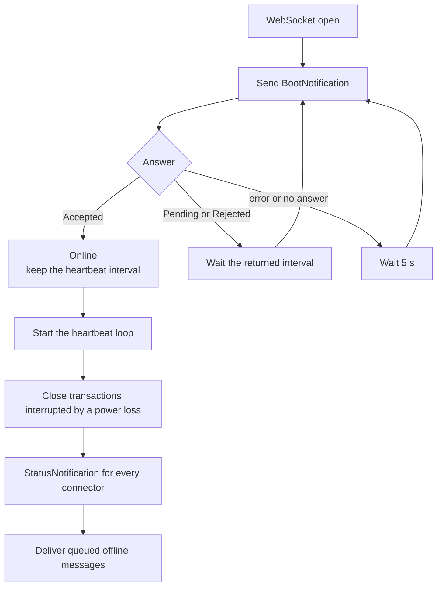
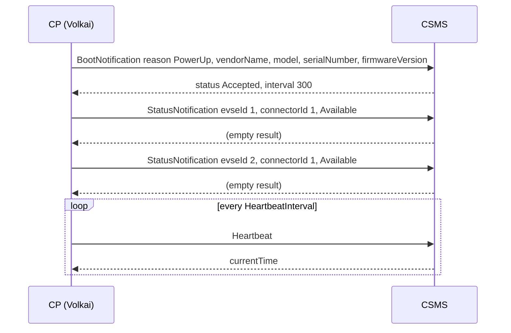
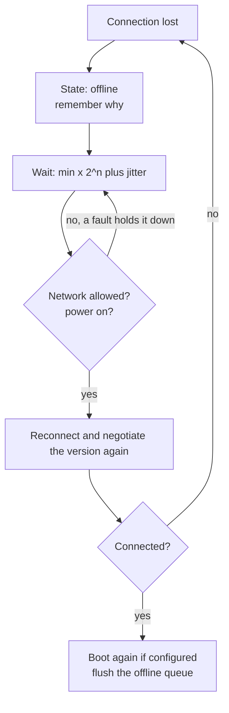

# 1. Connect, versions and boot

[Guide index](README.md) · next: [Sessions and cards](02-sessions-and-cards.md)

This page covers everything that happens before the first charge: telling Volkai where your CSMS is, how it decides between OCPP 1.6 and 2.0.1, how
it boots and brings every connector online, and how it behaves when the connection drops.

## 1.1 Charger identity and the connection URL

**What it is.** A simulated charger is defined by two things you type: the **WebSocket URL of your CSMS** and a **charger ID**. Everything else has a sensible
default (hardware, vehicle, identity). There is no database: chargers live in memory, and the form remembers your last entries in the browser.

**How it works.** Volkai joins the two with a slash, so the URL you type is a *base*:

| You type | Charger ID | Volkai connects to |
|---|---|---|
| `ws://127.0.0.1:8000/ocpp` | `CP001` | `ws://127.0.0.1:8000/ocpp/CP001` |
| `wss://csms.example.com/ocpp/` | `PUNE-07` | `wss://csms.example.com/ocpp/PUNE-07` |

The **Connects to** line in the form shows the final address and the subprotocol(s) that will be offered. A charger ID may contain letters, digits, `_`, `.` and `-`
(up to 60 characters).

**Security** (all optional, all in the form):

| Setting | Effect |
|---|---|
| Password | Sent as HTTP Basic authentication, with the charger ID as the user name. Used with security profile 1 or higher |
| Security profile | `0` none, `1` Basic auth over `ws://`, `2` Basic auth over TLS (`wss://` required), `3` TLS with a client certificate (the client certificate files cannot be set in the form yet) |
| Verify TLS certificate | On by default for `wss://`. Turn it off for a test server with a self-signed certificate |

**Try it.**

1. Click **Add charger**. Type `ws://127.0.0.1:8000/ocpp` and `CP001`. Leave the rest. Click **Add charger**.
2. The header shows `connecting`, then `booting`, then `online`.
3. The same through the API:

```bash
curl -s -X POST http://localhost:8100/api/stations -H 'content-type: application/json' \
  -d '{"ocpp_id":"CP001","csms_url":"ws://127.0.0.1:8000/ocpp","ocpp_version":"auto","connect":true}'
```

## 1.2 OCPP version and Auto detection

**What it is.** One charger speaks **one** OCPP version per connection. You choose it per charger:

| Choice | What Volkai offers your CSMS | Use it when |
|---|---|---|
| **Auto** (default in the form) | `ocpp2.0.1` and `ocpp1.6`, in that order | You do not know, or the same test must work against any CSMS |
| **OCPP 2.0.1** | `ocpp2.0.1` only | The CSMS must be tested on 2.0.1 |
| **OCPP 1.6J** | `ocpp1.6` only | The CSMS must be tested on 1.6, or it offers both and you want 1.6 |

**How Auto recognises the version.** It does not guess from message contents. The WebSocket handshake has a standard field, `Sec-WebSocket-Protocol`, in which the
client lists the protocols it speaks and the server answers with the one it picked. Volkai lists both; whatever the CSMS answers becomes the version for that
connection. The header chip (`OCPP 1.6` or `OCPP 2.0.1`) and the sidebar show the result.

### Flow



### Sequence



**What differs between the two versions.**

| | OCPP 2.0.1 | OCPP 1.6J |
|---|---|---|
| Connectors | EVSE 1, connector 1 | Numbered 1..N across the whole charger. Connector 0 is the station itself |
| Connector status | Available, Occupied, Reserved, Unavailable, Faulted | Available, Preparing, Charging, SuspendedEV, SuspendedEVSE, Finishing, Reserved, Unavailable, Faulted |
| A session | `TransactionEvent` Started / Updated / Ended | `StartTransaction` (the CSMS returns an integer id), `MeterValues`, `StopTransaction` |
| A fault | `NotifyEvent` | `StatusNotification` with an `errorCode` |
| Settings | Device model (`GetVariables` / `SetVariables`) | Configuration keys (`GetConfiguration` / `ChangeConfiguration`) |
| Remote control | `RequestStartTransaction` / `RequestStopTransaction` | `RemoteStartTransaction` / `RemoteStopTransaction` |

**Try it: see Auto choose.** Start the bundled mock CSMS on two ports with different versions, then add the same charger twice with **Auto**:

```bash
cd backend
.venv/bin/python -m ocpp_simulator.mock_csms --port 9201 --versions 1.6      # speaks only 1.6
.venv/bin/python -m ocpp_simulator.mock_csms --port 9202 --versions 2.0.1    # speaks only 2.0.1
```

Add one charger with URL `ws://127.0.0.1:9201/ocpp` and one with `ws://127.0.0.1:9202/ocpp`, both on **Auto**. The first shows the chip `OCPP 1.6`, the second
`OCPP 2.0.1`, and the live log of each shows that version's messages.

**Good to know.**

- If your CSMS speaks both, it chooses, and most pick the first one offered (2.0.1). To test 1.6 there, set the version to **OCPP 1.6J**.
- The version is decided again on every reconnect.
- Forcing a version your CSMS does not speak fails with a message such as `CSMS refused the connection: unsupported subprotocol: ocpp1.6 ... set this charger's OCPP version to Auto or 1.6`.

## 1.3 Boot and connectors online

**What it is.** The first thing a charger does is announce itself with `BootNotification`. When the CSMS accepts, Volkai reports **every connector as Available**, then starts the heartbeat.

**How it works.**

1. Send `BootNotification` with the charger's identity: vendor, model, serial number, firmware version and, if set, ICCID, IMSI (and for 1.6 the charge box serial, meter type and meter serial).
2. The answer decides what happens next:
   - `Accepted`: the charger is online. The `interval` the CSMS sends becomes the heartbeat interval.
   - `Pending` or `Rejected`: Volkai waits the interval the CSMS returned and sends the boot again.
3. After `Accepted`, start the heartbeat, finish what a reboot interrupted (close open transactions after a power loss), send a `StatusNotification` for every connector, and deliver any queued messages.

### Flow



### Sequence (OCPP 2.0.1)



On **OCPP 1.6** the same order applies, but the statuses are `StatusNotification` with a `connectorId` (and `errorCode: NoError`), plus one more for connector `0`, the station itself.

**Try it.** After adding the charger, the Connectors tab shows every connector as **Available**, and the live log (bottom of the page) reads:

```
CP → CSMS  BootNotification        Boot (PowerUp) · SIM-AC-22D
CSMS → CP  BootNotification        BootNotification → Accepted
CP → CSMS  StatusNotification      Connector 1/1 → Available
CP → CSMS  StatusNotification      Connector 2/1 → Available
```

**Boot reasons (2.0.1).** After a reboot the next boot carries the reason: `PowerUp` (first boot and after a power loss), `RemoteReset` (your CSMS sent Reset), `Watchdog`,
`Triggered` (your CSMS sent TriggerMessage), `ScheduledReset`, `LocalReset`, `FirmwareUpdate`, `ApplicationReset`, `Unknown`. The Connectors tab has **Reboot with this reason**
to send one by hand (see [Tools](08-tools.md)).

## 1.4 Heartbeat

**What it is.** A periodic `Heartbeat` that tells the CSMS the charger is alive and lets the charger read the CSMS clock.

**How it works.** The interval starts as the one in the boot answer, and is stored as `OCPPCommCtrlr.HeartbeatInterval` (2.0.1) or the `HeartbeatInterval` key (1.6). The loop **re-reads it every second**,
so if your CSMS changes it (`SetVariables` / `ChangeConfiguration`) or you edit it in the Device model tab, it takes effect at once. The header shows the current value.

**Try it.** In the Device model tab set `OCPPCommCtrlr.HeartbeatInterval` to `5`: heartbeats now appear every 5 seconds (tick **hide heartbeats** off in the log to see them).

## 1.5 Reconnect and back-off

**What it is.** When the connection drops (your CSMS restarts, the network fails), the charger reconnects by itself with an increasing wait, like a real one.

**How it works.** The wait before attempt *n* is `RetryBackOffWaitMinimum × 2^min(n, RetryBackOffRepeatTimes) + random(0..RetryBackOffRandomRange)` seconds. With the
defaults (2, 3, 2) the waits are about 2, 4, 8, then 16 seconds (plus up to 2 s of jitter), and 16 stays the maximum. All three are device model variables you can change.
The **Reconnects** counter in the header counts them, and the error that caused the drop is shown under the charger name.



While offline, a session that is running **continues**, and its messages wait in the offline queue (details in [Faults: network loss](04-faults-and-injection.md#43-network-loss-and-the-offline-queue)).

**Try it.** Stop your CSMS for a moment: the header turns `offline`, `Reconnects` goes up each attempt, and when the CSMS is back the charger returns to `online` and boots again
(unless you turned off *Send BootNotification again after every reconnect* in Edit).

## 1.6 Time scale (speed-up)

**What it is.** A slider (1× to 600×) that makes charging fast, so a full battery takes seconds instead of hours.

**How it works.** It multiplies **only** the energy added and the battery level. Protocol timers (heartbeat, timeouts, sample interval) stay real, so your CSMS sees realistic timing with fast energy.
At 60×, an 11 kW charge adds about 0.18 kWh per real second.

## 1.7 Hardware: presets, custom EVSEs and identity

**What it is.** What the charger *is*: how many EVSEs, how much power, AC or DC, which connectors, and the identity it announces.

| Preset | Charger |
|---|---|
| `ac_7` | AC wallbox, 7.4 kW, 1 connector |
| `ac_22_dual` | AC pedestal, 2 × 22 kW (the default) |
| `dc_60_dual` | DC fast, 2 × 60 kW (CCS2 and CHAdeMO on one EVSE) |
| `dc_150` | DC ultra-fast, 150 kW, CCS2 |
| `mixed_hub` | Hub: 2 × AC 22 kW and 1 × DC 60 kW |

Choose **Custom** to edit each EVSE (AC or DC, kW, phases, volts, connector types, 1 to 8 EVSEs). Open **Charger identity** in the form to set the vendor, model, firmware,
serial numbers, ICCID, IMSI and (for 1.6) charge box serial, meter type and meter serial: these are exactly what the CSMS receives in `BootNotification`.

## 1.8 Editing a charger and saved CSMS addresses

**Edit** (in the charger header) opens the same form. Some settings can change while the charger is connected, the rest need a disconnect first:

| Change any time | Disconnect first |
|---|---|
| Name, speed-up, re-boot after reconnect, end session when full, auto charge, the cards, Finishing mode | CSMS URL, charger ID, password, security profile, OCPP version, TLS, hardware, identity, smart plug |

Changing the hardware replaces all EVSEs and resets the device model; it is refused while a vehicle is plugged in, a fault is active or the offline queue is not empty.

**Saved CSMS addresses.** *Save this address* gives the URL a name (for example `dev server`); pick it later from **Saved CSMS**. They are kept in your browser only.

**Access token screen.** If the server was started with `SIM_TOKEN`, you see a login first (the API and the live updates need it). See the README for running it behind a tunnel.

---
Next: [Sessions and cards](02-sessions-and-cards.md)
