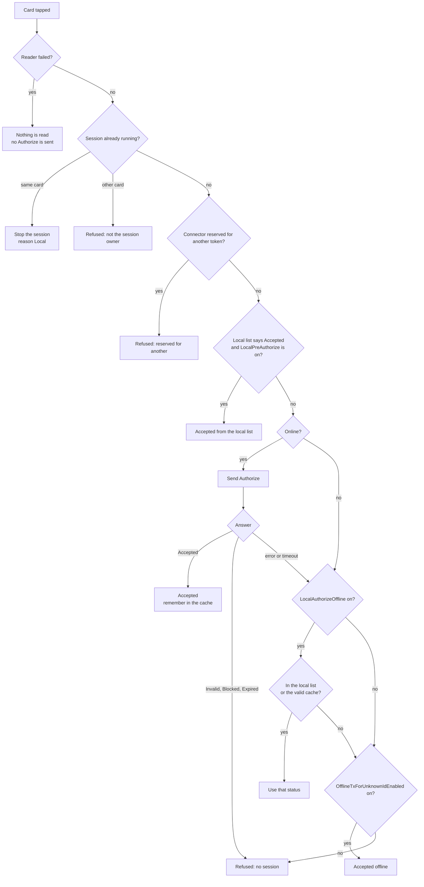
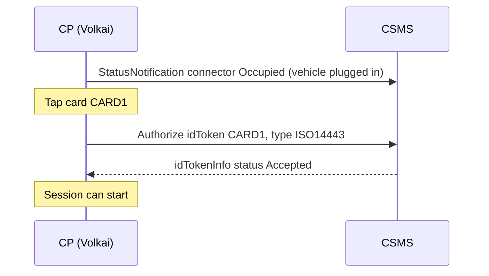
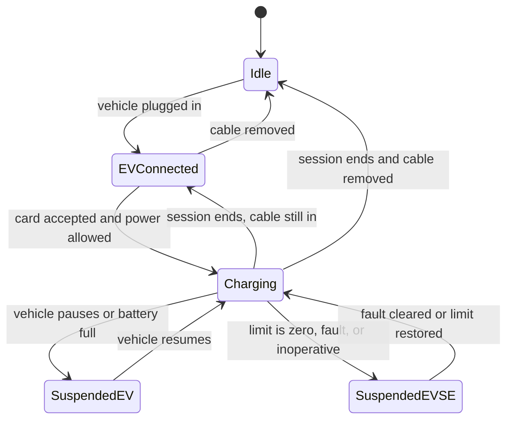
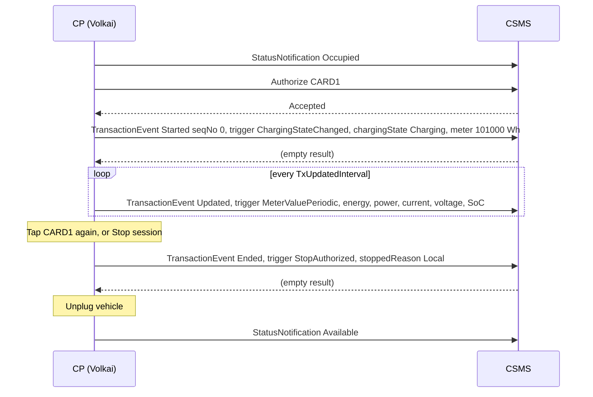
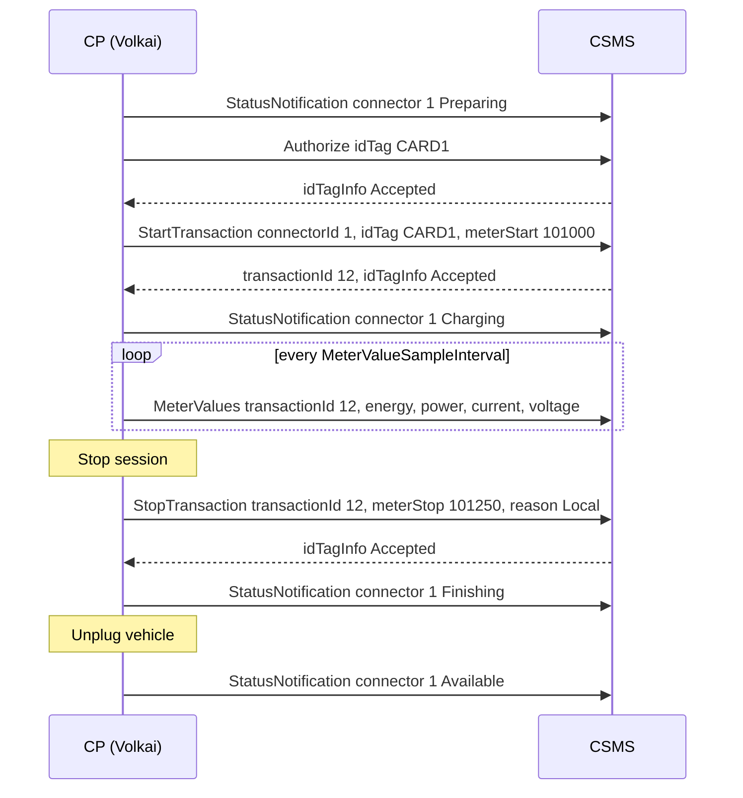
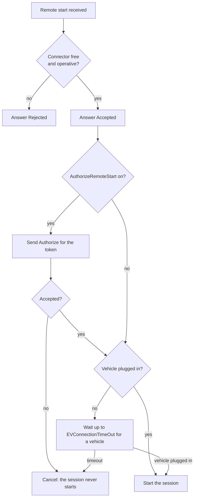
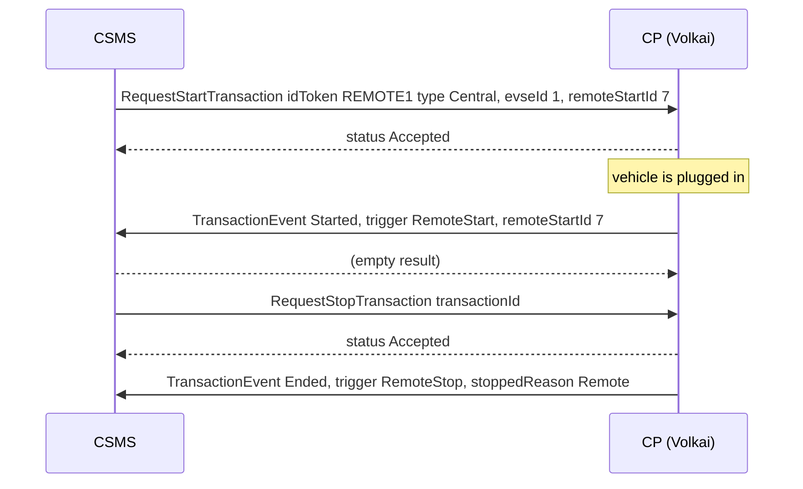
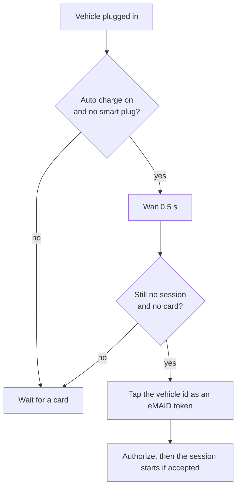
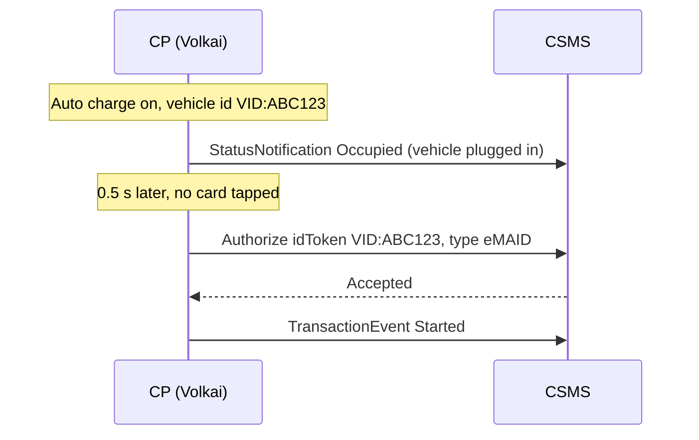
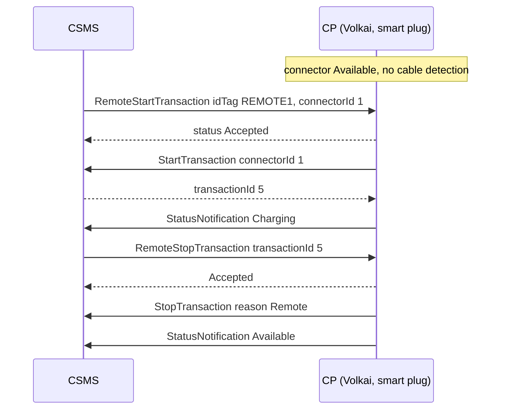

# 2. Sessions and cards

[Guide index](README.md) · previous: [Connect, versions and boot](01-connect-and-versions.md) · next: [Metering and V2G](03-metering-and-v2g.md)

A **session** (OCPP calls it a transaction) is one charge, from the moment a driver is authorized to the moment it ends. This page explains how a session starts
and ends in Volkai, on both OCPP versions, and the features around it: cards, remote start, auto charge, smart plug, reservations and the rest.

## 2.1 Vehicles and plugging in

**What it is.** A simulated electric vehicle with a battery, a start level, a target level and the power it can accept. You plug it into a connector like a driver would.

**How it works.** The vehicle models are listed in the [settings reference](reference/settings.md#vehicles): `city` (30 kWh), `mid` (60 kWh), `large` (100 kWh) and `scooter` (3 kWh).
The charging power is the smallest of: the charger's limit (including any charging profile from your CSMS), the vehicle's own maximum for AC or DC, and the EVSE rating. On DC the power **tapers** above 80 % battery.
Plugging in sets the connector status (`Occupied` on 2.0.1, `Preparing` on 1.6); nothing is charged until a card has been accepted.

**Try it.** On the Connectors tab pick a vehicle, set **Start SoC** to 20 % and **Charge to** 100 %, click **Plug in vehicle**. The connector turns `Occupied` (1.6: `Preparing`) and the live log shows the status.

```bash
curl -s -X POST http://localhost:8100/api/stations/$ID/evse/1/plug-in -H 'content-type: application/json' \
  -d '{"connector":1,"ev":"mid","soc":20,"target_soc":100}'
```

During a session the same card lets you: **Vehicle pauses** / **Resume** (the vehicle stops drawing power), **SoC +10**, **Make full** (the battery reaches its target at once), and **Unplug**.

## 2.2 Cards and authorization

**What it is.** A driver identifies with a card (an RFID id token). Volkai asks your CSMS to approve it with `Authorize`, and only an `Accepted` answer lets the session start.

**How it works.** The **Tap card** button (or `POST .../tap`) runs the following. The three offline fallbacks are controlled by the device model variables shown.



| Variable (2.0.1 device model; 1.6 key in brackets) | Default | Effect |
|---|---|---|
| `AuthCtrlr.LocalPreAuthorize` (`LocalPreAuthorize`) | off | Accept a card from the local list **without** asking the CSMS |
| `AuthCtrlr.LocalAuthorizeOffline` (`LocalAuthorizeOffline`) | on | While offline, trust the local list and the cache |
| `AuthCtrlr.OfflineTxForUnknownIdEnabled` (`AllowOfflineTxForUnknownId`) | off | While offline, accept any card |
| `AuthCacheCtrlr.Enabled` (`AuthorizationCacheEnabled`) / `LifeTime` | on / 86400 s | Remember cards the CSMS accepted; valid for the lifetime |

The tap result is one of `Accepted`, `Invalid` / `Blocked` / `Expired` (the CSMS refused), `Stopped` (the same card ended the session), `NotTheSessionOwner`,
`ReservedForOther`, `Unavailable` (the connector is faulted or inoperative) or `ReaderFailure`.

**Token types (2.0.1).** Next to the card box you can pick `ISO14443` (default), `ISO15693`, `eMAID`, `Central`, `Local` or `NoAuthorization`; it goes into the `idToken.type` field. OCPP 1.6 has no types, and cuts a card id to 20 characters (its `idTag` limit).

### Sequence (card accepted, OCPP 2.0.1)



**Try it: a refused card.** Tap `UNKNOWN-0000` while connected to a CSMS that does not know it. The tap result is `Invalid`, the log shows `Authorize → Invalid`, and no session starts.
That is the expected behaviour, and is what the scenario `unknown_token` checks.

## 2.3 The cards used by tests

**What it is.** The card id that the **Tap card** box starts with and that **every built-in scenario** taps. Two are configured per charger: the **card** (default `CARD1`) and a **second card** (default `CARD2`, used by scenarios that run two sessions at once).

**Why it matters.** A real CSMS only accepts cards it knows. If your CSMS has never heard of `CARD1`, every scenario that charges will stop at "Charging starts", because the CSMS answers `Invalid`. Set the card to one your CSMS accepts: in **Add charger** or **Edit** (under the OCPP version), field **Card used by the Tap button and the tests**.

**How it works.** Scenario steps use the placeholders `$card` and `$card2`, resolved when the step runs. When a step times out because the CSMS refused the card, the failure message says so:

```
Charging starts: timed out after 20s waiting for expect:tx_state evse=1, state=Charging.
The CSMS refused the card 'CARD1' (Invalid): register it in your CSMS, or set the cards this charger uses (Edit charger, 'Cards used by tests').
```

**Try it.**

```bash
curl -s -X PATCH http://localhost:8100/api/stations/$ID -H 'content-type: application/json' -d '{"card_id":"MY-REAL-CARD","card_id_2":"MY-OTHER-CARD"}'
```

The card can be changed while the charger is connected. The `unknown_token` scenario always uses its own made-up card, because it needs one the CSMS does **not** know.

## 2.4 A session from start to end

**What it is.** The life of one charge. The **charging state** of the session moves between these states:



### OCPP 2.0.1: `TransactionEvent`

By default (`TxCtrlr.TxStartPoint = PowerPathClosed`) the session starts when a card has been accepted **and** power can flow. Other start points (`EVConnected`, `Authorized`) start it earlier.
`TxStopPoint` (default `EVConnected,Authorized`) decides what ends it: unplugging or a stop card.



`seqNo` counts up from 0 within the transaction. The `Started` event carries the card (`idToken`) once, and the meter register at the start (`Transaction.Begin`).

### OCPP 1.6J: `StartTransaction`, `MeterValues`, `StopTransaction`



The transaction id is whatever **your CSMS** returns in the `StartTransaction` answer; Volkai remembers it and uses it in every later `MeterValues` and in `StopTransaction`.
If the CSMS answers the start with a status other than `Accepted` (for example `Invalid`), Volkai stops the session at once with reason `DeAuthorized`.

**Try it (either version).**

1. Plug in a vehicle, tap a card the CSMS accepts: the connector shows **Charging**, the meter box shows power in kW and the session energy in kWh.
2. Wait a few seconds: the session energy grows, and the log shows the periodic updates.
3. Click **Stop session** (or tap the same card): the log shows the end message, and the connector goes `Occupied` (1.6: `Finishing`).
4. **Unplug**: the connector goes `Available`.

```bash
curl -s -X POST http://localhost:8100/api/stations/$ID/evse/1/tap    -H 'content-type: application/json' -d '{"token":"CARD1"}'
curl -s -X POST http://localhost:8100/api/stations/$ID/evse/1/stop   -H 'content-type: application/json' -d '{"reason":"Local"}'
curl -s -X POST http://localhost:8100/api/stations/$ID/evse/1/unplug
```

## 2.5 How a session ends: stop reasons

The **Stop session** button has a reason menu; the other reasons happen by themselves.

| Reason | When it happens |
|---|---|
| `Local` | You tap the same card or click Stop session |
| `Remote` | Your CSMS sent `RequestStopTransaction` / `RemoteStopTransaction` |
| `EVDisconnected` | The vehicle is unplugged (or the `cable_unplugged` fault) |
| `StoppedByEV` | The battery reached its target (`end on full` is on) |
| `DeAuthorized` | 1.6: the CSMS refused the card in the `StartTransaction` answer |
| `EmergencyStop`, `GroundFault`, `OvercurrentFault`, `PowerQuality` | The matching [fault](04-faults-and-injection.md) |
| `PowerLoss` | After a power cut, when the charger comes back (see [power loss](04-faults-and-injection.md#42-power-loss)) |
| `ImmediateReset`, `Reboot` | Your CSMS reset the charger, or the watchdog rebooted it |
| `Timeout` | A card was accepted but no vehicle was plugged in within `TxCtrlr.EVConnectionTimeOut` (60 s). With the default start point no session exists yet, so the authorization simply expires (the log says *authorisation expired*); with start point `Authorized` the session already started and ends with this reason |
| `Other` | A fault that ends the session without a better name, for example the meter failure with *stop session* |

OCPP 1.6 has a shorter list: `ImmediateReset` becomes `HardReset`, and a reason 1.6 has no word for is sent as `Other`.

## 2.6 Remote start and remote stop (from your CSMS)

**What it is.** The CSMS starts or stops a session for a driver without a card, for example from a mobile app. Volkai answers like a real charger.

**How it works.** For `RequestStartTransaction` (2.0.1) or `RemoteStartTransaction` (1.6) the charger **answers `Accepted` first** and only then does the work, as the standard requires:





On **1.6** the messages are `RemoteStartTransaction` (with `idTag` and `connectorId`) answered `Accepted`, then `StartTransaction`; and `RemoteStopTransaction` with the integer `transactionId`.

**Try it.** No CSMS needed: use **Simulate a command** in the Messages tab (see [Tools](08-tools.md#82-simulate-a-csms-command)). Plug in a vehicle, choose `RequestStartTransaction` (1.6: `RemoteStartTransaction`), click Run: the session starts. Choose `RequestStopTransaction` with the shown transaction id and Run: it ends with reason `Remote`.

## 2.7 Auto charge

**What it is.** Plug-and-charge: the vehicle identifies **itself** as soon as it is plugged in, so no card is tapped. Real systems do this with a vehicle id (for example ISO 15118 plug and charge, or a vehicle id read from the car).

**How it works.** Half a second after the cable goes in, if no session is running and no card is waiting, Volkai taps a card as if the driver did, using the **vehicle id** you set (default `VID:FCA47A10DC70`, up to 20 characters) with token type `eMAID`. It then takes exactly the normal path: `Authorize`, and a session if accepted. If your CSMS refuses the vehicle id nothing starts, which is the useful thing to test.





**Try it.** Tick **Auto charge** in Add / Edit, set the vehicle id, plug in a vehicle: the session starts by itself and the log shows `auto charge, the vehicle presents VID:...`. The scenario `auto_charge` does the same and checks it.

## 2.8 Smart plug

**What it is.** A socket with no cable detection: the connector never shows that something is plugged in. It stays `Available` until your CSMS sends a **remote start**, then goes straight to charging, and returns to `Available` when the session ends.

**How it works.** With **Smart plug** on (set before connecting), plugging in does nothing visible, and a card tap has nothing to start. A remote start itself "switches the socket on" with the connected load: it creates the vehicle, starts the session and reports `Occupied` (2.0.1) or `Charging` (1.6). When the session ends the socket switches off, so there is no `Preparing` or `Finishing` status at all.



**Try it.** Tick **Smart plug** when adding the charger, connect, then run the scenario `smart_plug_remote_start` from the Test cases tab (it simulates the remote start for you), or use **Simulate a command** with a remote start.

## 2.9 Finishing mode (OCPP 1.6)

**What it is.** In OCPP 1.6, after a session ends while the cable is still plugged in, the connector reports `Finishing` until the cable is removed. Some chargers report `Preparing` instead; the switch lets you test both.

**How it works.** **Finishing mode** is on by default. Turn it off in Add / Edit: after a stop the connector reports `Preparing`, and after the unplug `Available`.

## 2.10 Reservations

**What it is.** The CSMS holds a connector for one driver until a time.

**How it works.** `ReserveNow` makes the connector `Reserved`. Only the reserved token can start a session there (any other card is refused with `ReservedForOther`), and the matching token **uses up** the reservation (the reservation id is carried in the `Started` / `StartTransaction`). A reservation that is not used expires: the connector returns to `Available` and a 2.0.1 charger sends `ReservationStatusUpdate` with `Expired`. `CancelReservation` removes it. The **State** tab lists the active reservations.

**Try it.** With **Simulate a command**, run `ReserveNow` (the sample has a valid body). The connector becomes `Reserved`; tap a different card and the tap result is `ReservedForOther`.

---
Previous: [Connect, versions and boot](01-connect-and-versions.md) · Next: [Metering and V2G](03-metering-and-v2g.md)
