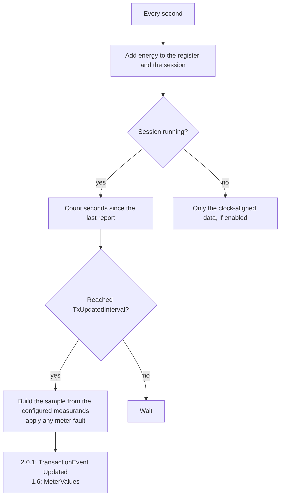
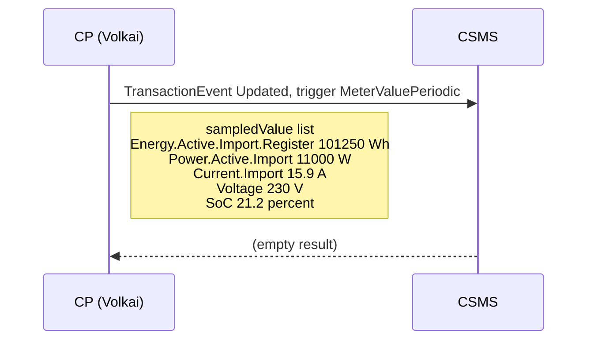
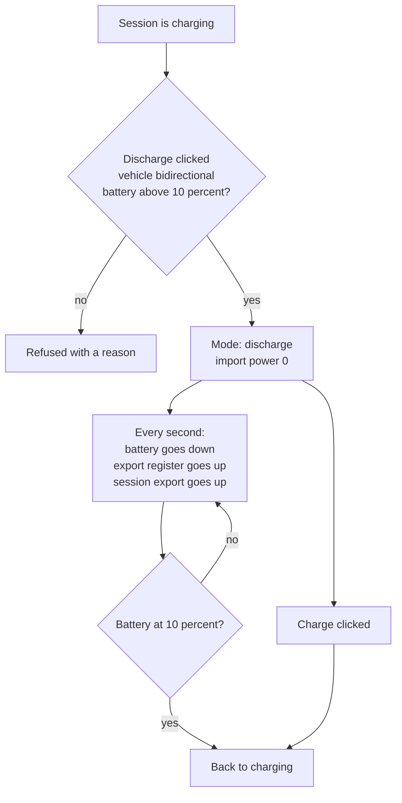
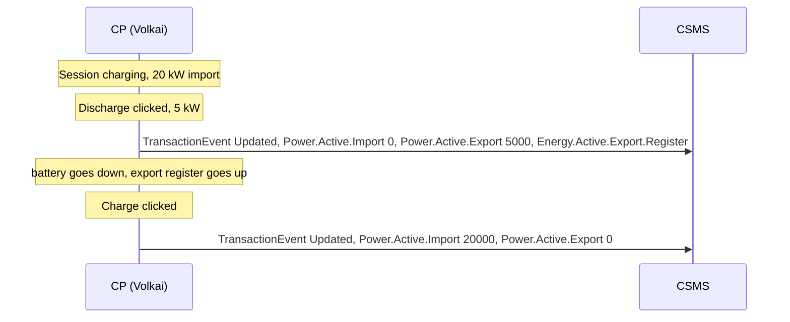

# 3. Metering and V2G

[Guide index](README.md) · previous: [Sessions and cards](02-sessions-and-cards.md) · next: [Faults and injection](04-faults-and-injection.md)

How energy is measured, what the charger reports to your CSMS and when, how to bend the numbers on purpose, and how a vehicle can feed energy back to the grid.

## 3.1 Two numbers: the register and the session energy

**What it is.** A charger has an energy meter that only ever counts up, over its whole life: the **register**. A **session's energy** is the difference between the register at the end of the session and the register at the start.

| | Meaning | Example |
|---|---|---|
| **Register** | The lifetime import counter, in Wh. Starts at about 101 kWh for EVSE 1 and 102 kWh for EVSE 2 | 101 250 Wh |
| **Session energy** | What this charge used | 101 250 − 101 000 = **250 Wh** |

**Why it matters.** Real chargers send the **register**, not the session energy. A CSMS that stores the register as the session's energy bills a 6-second session as 101 kWh. This is a classic CSMS bug, and Volkai is built to expose it: the numbers it sends are exactly what a real charger sends.

**How it works.** On every tick (once a second) a charging EVSE adds `power × time × speed-up` to the register and to the session. The EVSE's [Connectors tab](08-tools.md) shows the register (top right, in kWh) and the session energy (the *Session* box).

## 3.2 Measurands, sampling and contexts

**What it is.** A *measurand* is one kind of reading: energy, power, current, voltage, battery level, and so on. The charger sends a set of them at certain moments.

**How it works.** Which measurands go out, and when, is configured in the device model (2.0.1) or configuration keys (1.6), and **your CSMS can change it**:

| When | 2.0.1 variable | 1.6 key | Default |
|---|---|---|---|
| A session starts (`context Transaction.Begin`) | `SampledDataCtrlr.TxStartedMeasurands` | (the `StartTransaction` carries `meterStart`) | Energy register |
| Every N seconds during a session (`Sample.Periodic`) | `SampledDataCtrlr.TxUpdatedInterval` and `TxUpdatedMeasurands` | `MeterValueSampleInterval` and `MeterValuesSampledData` | 10 s; energy, power, current, voltage, SoC |
| A session ends (`Transaction.End`) | `SampledDataCtrlr.TxEndedMeasurands` | `StopTxnSampledData` | Energy register |
| On the clock (`Sample.Clock`) | `AlignedDataCtrlr.Interval` and `Measurands` | `ClockAlignedDataInterval` and `MeterValuesAlignedData` | Off (0) |
| When your CSMS asks (`Trigger`) | `TriggerMessage` | `TriggerMessage` | n/a |

The measurands Volkai can report: `Energy.Active.Import.Register`, `Energy.Active.Export.Register`, `Power.Active.Import`, `Power.Active.Export`, `Current.Import`, `Current.Export`,
`Voltage`, `SoC`, `Power.Offered`, `Current.Offered`, `Frequency`, `Temperature` (OCPP 1.6 only; in 2.0.1 it is not a measurand and is never sent as one) and `Power.Factor`.



### Sequence: what one report looks like



**Try it.**

1. In the Device model tab set `SampledDataCtrlr.TxUpdatedInterval` to `3`.
2. Start a session. A report appears every 3 seconds. Click one in the live log to see the raw JSON with every sampled value.
3. Add `Power.Factor` to `SampledDataCtrlr.TxUpdatedMeasurands` (a comma-separated list). The next report contains it.

On 1.6 the same is done with the key `MeterValueSampleInterval` and `MeterValuesSampledData` in the *Configuration keys* tab.

## 3.3 Set the meter register by hand

**What it is.** Overwrite the lifetime register of an EVSE, to see how your CSMS reacts to a jump, a rollback or a reset of the counter.

**How it works.** Type a kWh value under **Meter register** on the EVSE card and click **Set**. The register changes at once and every later reading continues from it.
(Not to be confused with the `power_meter_failure` *rollback* and *spike* modes, which corrupt the *reported* value while the real register is untouched; see [faults](04-faults-and-injection.md#41-power-meter-failure).)

**Try it.**

```bash
curl -s -X POST http://localhost:8100/api/stations/$ID/evse/1/meter -H 'content-type: application/json' -d '{"import_kwh": 5000}'
```

Start a session now: the `Started` event (2.0.1) or `meterStart` (1.6) carries 5 000 000 Wh. Set `0` between sessions to simulate a meter reset.

## 3.4 Power: limits, vehicle and the gun temperature

**What it is.** The power shown on the card, in kW.

**How it works.** The power of a charging EVSE is the **smallest** of:

1. the EVSE rating (for example 22 kW),
2. the **limit** from your CSMS: a charging profile installed with `SetChargingProfile`, or a grid limit from the `grid_overload` fault (see [commands](07-csms-commands.md#77-charging-profiles-and-power-limits)),
3. what the **vehicle** accepts (AC or DC maximum, and tapering above 80 % battery on DC),
4. reduced by the `over_temperature` fault in *derate* mode.

The shown **Limit** is the value of (1) to (2). The **gun temperature** follows the load: it rises about 0.35 °C per kW above a base of 28 °C, so a 22 kW charge settles near 36 °C. The `over_temperature` fault forces it to a value you choose.
The voltage is the EVSE's rating (230 V on AC); the `over_voltage` / `under_voltage` faults change it.

**Try it.** Charge a `large` vehicle on `dc_150`: power starts at 150 kW, tapers after 80 %, the temperature climbs, and the *Gun temp* box shows it. Then use **Simulate a command** with `SetChargingProfile` (a 3 kW limit) and watch the *Limit* and *Power* boxes drop.

## 3.5 Bidirectional charging (V2G)

**What it is.** A bidirectional vehicle can also **give energy back**: to the grid (V2G) or to a home (V2H). The charger then *exports* energy instead of importing it.

**How it works.** Only some vehicles can (the mid-size EV up to 10 kW and the large EV up to 20 kW; see the [settings reference](reference/settings.md#vehicles)). During a running session, click **Discharge (V2G)** with a power in kW:

- the import power drops to **zero** and the **export power** equals what you asked (capped by the vehicle and the EVSE),
- the battery level **goes down**, and the **export register** (`Energy.Active.Export.Register`) and the session's export energy go up,
- the import register does not move,
- at **10 % battery** the vehicle protects itself and returns to charging,
- **Charge (G2V)** returns to normal at any time.

The export values reach your CSMS as the measurands `Energy.Active.Export.Register`, `Power.Active.Export` and `Current.Export` once you add them to the sampled measurands (3.2).





**Try it.**

1. Add a charger on the `dc_150` preset. In Device model set `SampledDataCtrlr.TxUpdatedMeasurands` to `Energy.Active.Import.Register,Energy.Active.Export.Register,Power.Active.Import,Power.Active.Export,SoC`
   (1.6: set `MeterValuesSampledData`).
2. Plug in the `large` EV at 80 % and start a session.
3. Click **Discharge (V2G)** with 5 kW. The card shows *Feeding back 5.0 kW*, the SoC falls, and the log shows reports with `Power.Active.Export`.
4. Click **Charge (G2V)**.

The scenario `v2g_discharge` runs exactly this and checks that export energy flows.

```bash
curl -s -X POST http://localhost:8100/api/stations/$ID/evse/1/v2x -H 'content-type: application/json' -d '{"mode":"discharge","power_kw":5}'
curl -s -X POST http://localhost:8100/api/stations/$ID/evse/1/v2x -H 'content-type: application/json' -d '{"mode":"charge"}'
```

**Limits.** V2G here is a physical simulation of the meter readings and the battery. It does not run the ISO 15118-20 bidirectional negotiation, and OCPP 2.0.1 has no dedicated bidirectional messages: your CSMS sees the export measurands.

---
Previous: [Sessions and cards](02-sessions-and-cards.md) · Next: [Faults and injection](04-faults-and-injection.md)
