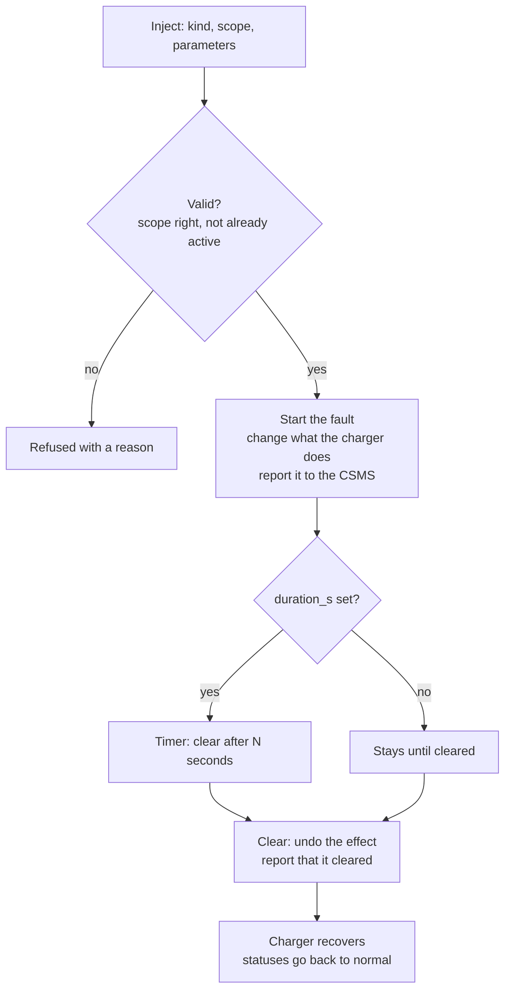
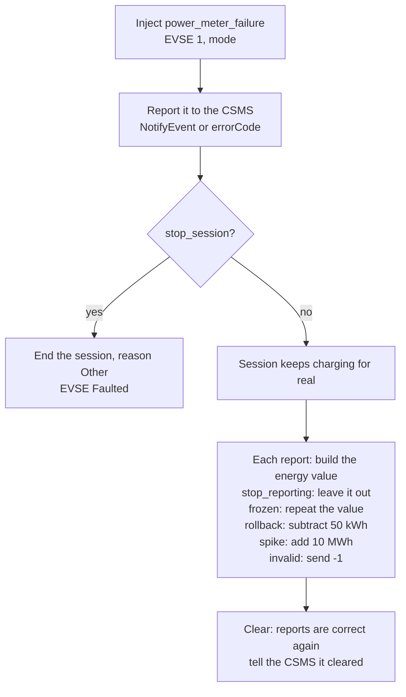
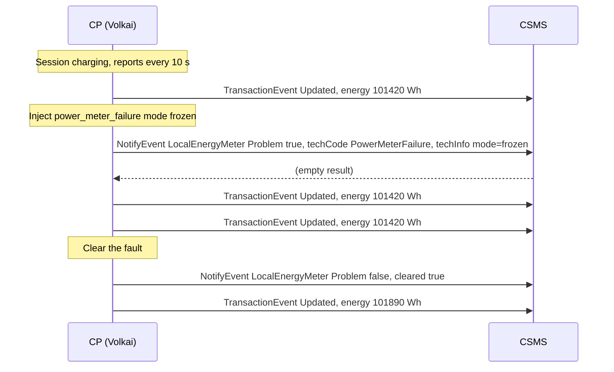
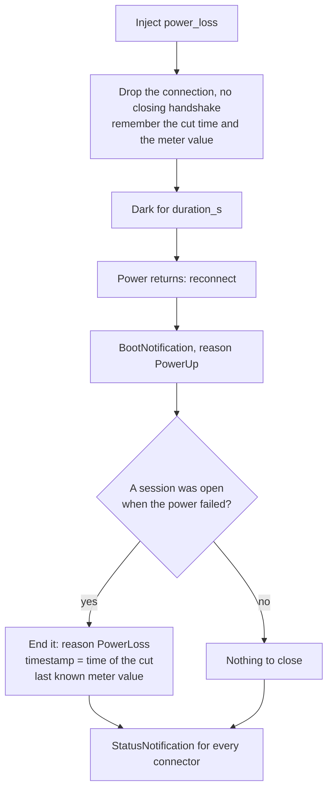
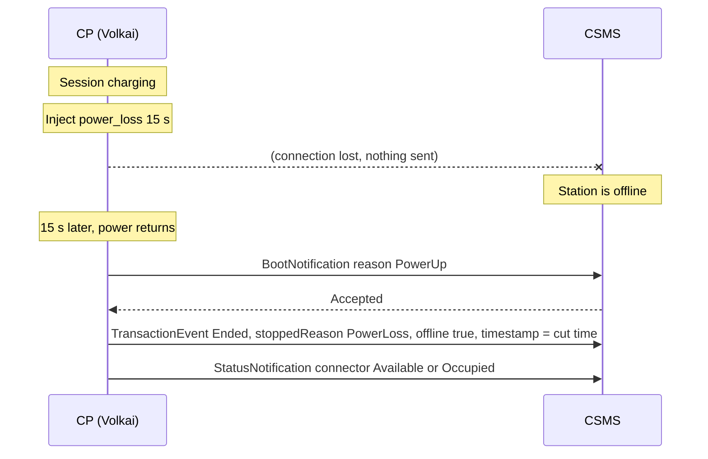
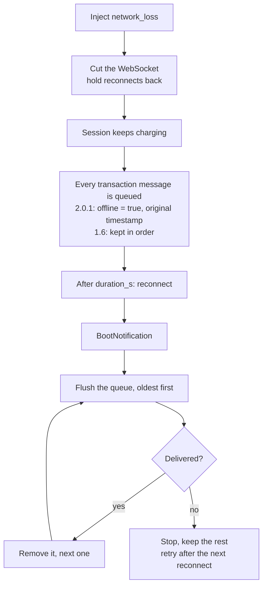
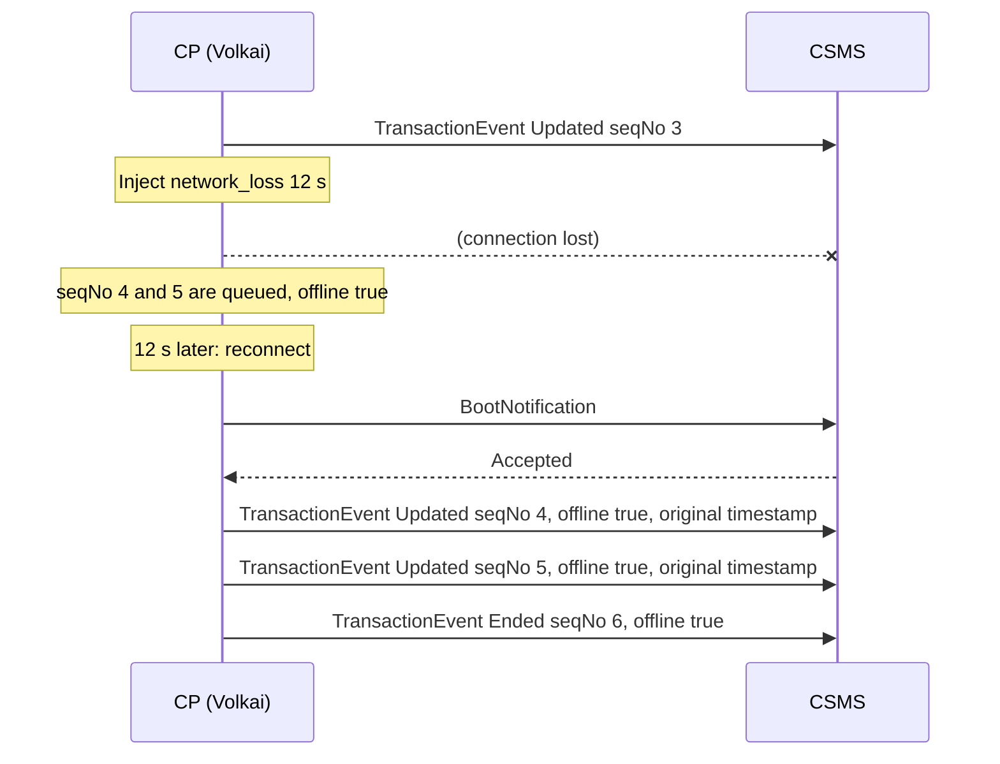

# 4. Faults and injection

[Guide index](README.md) · previous: [Metering and V2G](03-metering-and-v2g.md) · next: [Message rules](05-message-rules.md)

This is the heart of "break it on purpose": inject a real-world failure into a running charger and watch how your CSMS copes. There are 24 faults; the full list, with
every parameter, is in the [fault reference](reference/faults.md). This page explains how injection works and walks through the failures people test most.

## 4.0 How fault injection works

**What it is.** A *fault* is a failure the charger suffers: a dead meter, a power cut, a dropped network, an emergency button. You inject one, the charger reacts like real hardware (it stops sessions, goes Faulted, reports to your CSMS), and you clear it when you are done.

**How it works.**

| Part | Meaning |
|---|---|
| **Scope** | A fault applies to the **whole station** (power loss, network loss), to **one EVSE** (meter failure, over-current) or to **either** (emergency stop). EVSE faults need an EVSE number |
| **Parameters** | Each fault has a few settings (for example the meter failure *mode*). Every one has a default |
| **Duration** | Most faults have `duration_s`: the number of seconds after which the fault **clears itself**. `0` means until you clear it |
| **One-time events** | `tamper_detected`, `ev_battery_full`, `cable_unplugged` and `reboot_watchdog` happen once and have nothing to clear |
| **One at a time** | The same fault cannot be injected twice on the same scope; clear it first |
| **Clearing** | Clear one fault, or all of them. The charger recovers (connectors return to `Available` / `Occupied`) and tells the CSMS |



**Where in the UI.**

- **Faults tab:** one card per fault with its parameters and an **Inject** button, plus the *Active faults* list with a **Clear** button on each fault, a button to clear them all, and the recently ended ones.
- **Connectors tab:** quick buttons on each EVSE card (*Meter failure*, *Over-current*, *Ground fault*, *Emergency stop*) and on the whole-station bar (*Power loss 15 s*, *Network loss 20 s*, *Watchdog reboot*, *Emergency stop*).
- **API:**

```bash
# inject on EVSE 1, clear after 20 s
curl -s -X POST http://localhost:8100/api/stations/$ID/faults -H 'content-type: application/json' \
  -d '{"kind":"power_meter_failure","scope":1,"params":{"mode":"frozen","duration_s":20}}'
# clear one fault, or all
curl -s -X DELETE http://localhost:8100/api/stations/$ID/faults/3
curl -s -X DELETE http://localhost:8100/api/stations/$ID/faults
```

**How a fault shows up on each OCPP version.** Your CSMS learns about a fault differently on 1.6 and 2.0.1:

| Fault | OCPP 2.0.1: `NotifyEvent` (component, `techCode`) | OCPP 1.6: `StatusNotification` `errorCode` |
|---|---|---|
| `power_meter_failure` | `LocalEnergyMeter`, `PowerMeterFailure` | `PowerMeterFailure` |
| `over_current` | `OverCurrentBreaker`, `OverCurrent` | `OverCurrentFailure` |
| `ground_fault` | `GroundIsolationMonitoring`, `GroundFault` | `GroundFailure` |
| `over_voltage` / `under_voltage` | `ElectricalFeeder`, `OverVoltage` / `UnderVoltage` | `OverVoltage` / `UnderVoltage` |
| `over_temperature` | `EVSE` variable `Temperature`, `OverTemperature` | `HighTemperature` |
| `emergency_stop`, `tamper_detected` | `EVSE` or `ChargingStation`, `EmergencyStop` / `TamperDetected` (and a `SecurityEventNotification` for tamper) | `OtherError` |
| `contactor_failure` | `PowerContactor`, `ContactorFailure` | `PowerSwitchFailure` |
| `connector_lock_failure` | `Connector`, `ConnectorLockFailure` | `ConnectorLockFailure` |
| `rfid_reader_failure` | `TokenReader`, `ReaderFailure` | `ReaderFailure` |

## 4.1 Power meter failure

**What it is.** The energy meter of one EVSE misbehaves while a session runs. Real meters do this: a communication fault, a stuck register, a reset to zero, a glitch. A good CSMS must notice, keep the session consistent and never bill nonsense.

**How it works.** Choose a **mode**. The session keeps running and the charger keeps adding real energy; only what is **reported** changes:

| Mode | What the charger reports | What a CSMS should do |
|---|---|---|
| `stop_reporting` | Reports **without** the energy register (the meter delivers nothing) | Keep the last known value, do not bill from missing data, flag the session |
| `frozen` | The register **stops changing**: the same value, report after report | Notice no energy is accruing |
| `rollback` | The register goes **backwards**: real value minus 50 000 Wh | Never let energy decrease, ignore or flag the reading |
| `spike` | The register jumps **up** by 10 000 000 Wh (10 000 kWh) | Reject the implausible jump, do not bill 10 MWh |
| `invalid` | The register reports an **invalid value** (-1 Wh) | Reject it, keep the previous value |

Two extra settings: **stop_session** ends the running session at once (reason `Other`) and marks the EVSE `Faulted`, like a charger that gives up on a dead meter; **duration_s** clears the fault by itself.
When the fault starts, and again when it clears, the charger tells your CSMS (the table in 4.0).





The 2.0.1 `NotifyEvent` carries (abridged):

```json
{ "generatedAt": "2026-10-20T10:15:00Z", "seqNo": 0, "eventData": [ {
    "eventId": 1, "trigger": "Alerting", "actualValue": "true", "eventNotificationType": "HardWiredNotification",
    "component": { "name": "LocalEnergyMeter", "evse": { "id": 1 } }, "variable": { "name": "Problem" },
    "cleared": false, "techCode": "PowerMeterFailure", "techInfo": "mode=frozen" } ] }
```

On **1.6** the equivalent is `StatusNotification { connectorId: 1, status: "Charging", errorCode: "PowerMeterFailure", vendorErrorCode: "PowerMeterFailure", info: "mode=frozen" }`.

**Try it: a frozen meter.**

1. Add a charger, set `SampledDataCtrlr.TxUpdatedInterval` to `3` (Device model tab), plug in a vehicle and start a session with a card your CSMS accepts.
2. Faults tab, card **Power meter failure**: EVSE 1, mode `frozen`, **Inject**.
3. In the log, click the next three updates: `Energy.Active.Import.Register` has the **same value** each time. The Connectors tab still shows real energy rising (the *Session* box).
4. **Clear**. The next update has the true, higher value.
5. What to check in **your CSMS**: the session is flagged or stalled, billing is not corrupted, and after the clear the energy resumes sensibly.

```bash
curl -s -X POST http://localhost:8100/api/stations/$ID/faults -H 'content-type: application/json' \
  -d '{"kind":"power_meter_failure","scope":1,"params":{"mode":"frozen"}}'
```

The scenarios `meter_failure`, `meter_frozen`, `meter_rollback`, `meter_spike`, `meter_invalid` and `meter_failure_stops_session` run each variant for you ([scenarios](reference/scenarios.md#metering)).

## 4.2 Power loss

**What it is.** The whole charger loses power, like a tripped breaker or a mains cut. Nothing is sent, the connection simply vanishes; when power returns the charger boots again and cleans up the session that was interrupted.

**How it works.**

1. **The cut.** The WebSocket closes **without a closing handshake** and the charger stops everything. A running session is remembered together with the **time of the cut** and the last meter value. The charger shows as `unpowered`.
2. **The wait.** For `duration_s` seconds (default 20) it stays dark. Reconnect attempts do not happen.
3. **Power returns.** The charger reconnects and boots with reason **`PowerUp`**.
4. **Clean-up.** After the boot is accepted, the interrupted session is closed with stopped reason **`PowerLoss`**, **timestamped at the moment of the cut** and flagged **offline** (2.0.1), carrying the last known meter value. Then the connector statuses are sent.





On **1.6** the close-out is a `StopTransaction` with `reason: "PowerLoss"` and the time of the cut.

**Try it.**

1. Start a session. Click **Power loss (15 s)** on the whole-station bar (or inject `power_loss`).
2. The header turns `unpowered`. In your CSMS the charger should show offline.
3. After 15 seconds the header returns to `online` and the log shows the boot with reason `PowerUp`, then the ended session with `PowerLoss`.
4. What to check in **your CSMS**: the session is closed with the right reason and the **end time is the time of the cut**, not the time of the reboot; the energy is the last value before the cut; the charger is online again.

The scenarios `power_loss_session` and `power_loss_idle` do this, with and without a running session.

## 4.3 Network loss and the offline queue

**What it is.** The charger keeps power but loses its connection to the CSMS. A session continues, and every message about it must be **kept and delivered later, in order**. This is how a real charger behaves on a poor mobile network.

**How it works.**

1. **The drop.** The WebSocket is cut and reconnects are held back. The charger shows `offline`.
2. **Offline charging.** The session continues. Each message that would have been sent is put into the **offline queue** instead: on 2.0.1 every `TransactionEvent` is stored with `offline: true` and its **original timestamp**; on 1.6 the `StartTransaction`, `MeterValues` and `StopTransaction` are stored the same way.
3. **The return.** After `duration_s` (default 20) the charger reconnects, boots again (unless you turned that off), and **flushes the queue in order**, oldest first. If a delivery fails or times out, it stops there and keeps the rest in the queue, so nothing is reordered or dropped; the flush is tried again after the next reconnect.

The header chip **Offline queue** and the State tab (*Offline queue*) show what is waiting.





**Try it.**

1. Set `SampledDataCtrlr.TxUpdatedInterval` to `3`, start a session.
2. Click **Network loss (20 s)**. The header shows `offline`; the **Offline queue** counter climbs every 3 seconds.
3. Optionally stop the session while offline: the `Ended` event is queued too.
4. After 20 seconds the charger reconnects and the counter drops to 0; the log shows the delayed messages with their **original** times and `offline: true`.
5. What to check in **your CSMS**: all events arrive in `seqNo` order, none is duplicated or lost, timestamps are the original ones (not the delivery time), and a session that ended offline is closed correctly.

The scenario `network_loss_session` does this and checks that at least two offline events are queued and then delivered.

## 4.4 Other faults at a glance

Everything else works the same way: inject, observe the reaction, clear. The reference lists each one with its parameters, effect and what your CSMS should do.

| Group | Faults | The idea |
|---|---|---|
| **Power and network** | `power_loss`, `network_loss`, `network_flapping`, `high_latency`, `packet_loss`, `reboot_watchdog` | Connection and power problems; slow or lossy links; a charger that crashes and reboots |
| **Electrical** | `over_voltage`, `under_voltage`, `over_current`, `ground_fault`, `over_temperature` | The charger protects itself: sessions stop with the matching reason and the EVSE goes `Faulted` until cleared (or the power is derated) |
| **Safety** | `emergency_stop`, `tamper_detected` | The emergency button; the enclosure opened |
| **Hardware** | `contactor_failure`, `connector_lock_failure`, `rfid_reader_failure` | The contactor will not close (no power flows); the lock jams (unlock fails); the card reader is dead (no `Authorize` is sent) |
| **Vehicle** | `ev_communication_loss`, `ev_suspends`, `ev_battery_full`, `cable_unplugged` | The car stops talking or drawing power; the battery fills up; the cable is pulled |
| **Smart charging** | `grid_overload` | An energy-management limit caps the site (`NotifyChargingLimit`, then `ClearedChargingLimit`) |
| **Time** | `clock_drift` | The charger's clock is wrong, so its timestamps are off |
| **Firmware** | `firmware_update_failure` | The next firmware update or log upload fails at a stage you choose |

## 4.5 Putting faults together

Faults are independent, so combine them to reproduce a messy real situation:

- A **meter failure** *during* a **network loss**: the meter freezes while the readings are queued offline.
- **High latency** plus a **message rule** that drops the first `StopTransaction` (see [Message rules](05-message-rules.md)): the end of a session over a bad link.
- **Power loss** while events are queued: the queue is kept, so after the reboot the charger delivers the old events first and then closes the interrupted session. This tests the order of events across a reboot.

Use **Clear all** between experiments, or start a [scenario](06-scenarios.md): every scenario begins by clearing all faults and unplugging all vehicles so one test cannot disturb the next.

---
Previous: [Metering and V2G](03-metering-and-v2g.md) · Next: [Message rules](05-message-rules.md)
