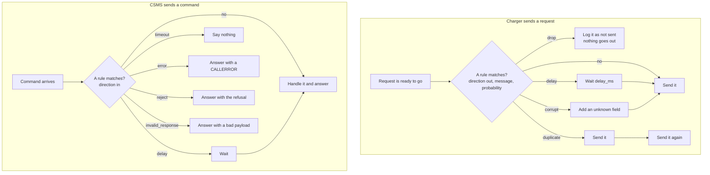
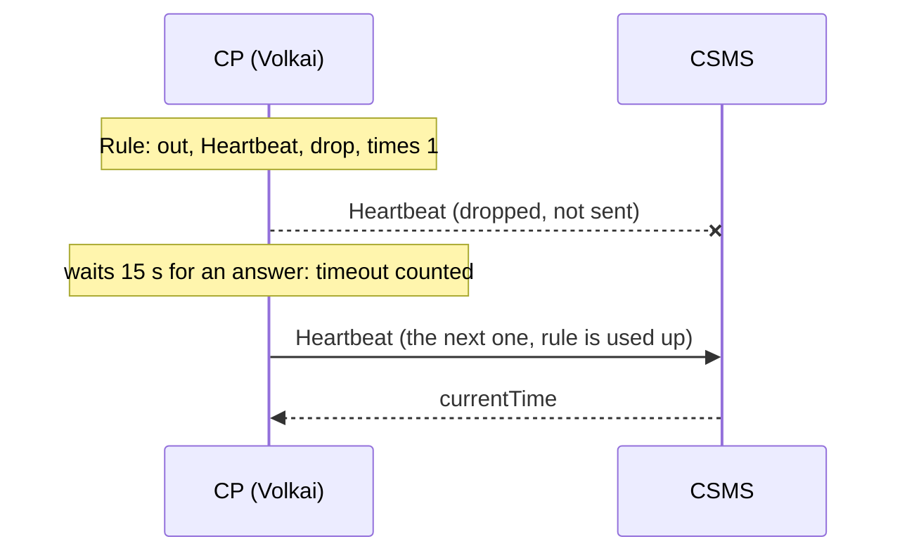
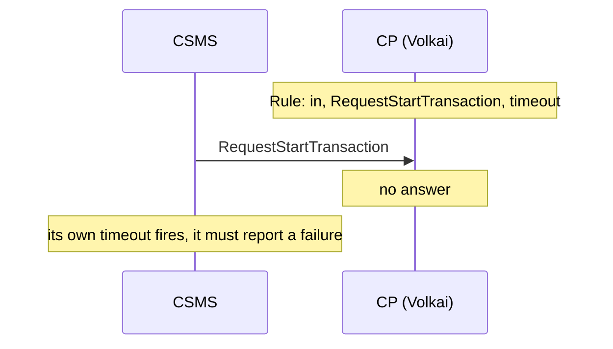

# 5. Message rules

[Guide index](README.md) · previous: [Faults and injection](04-faults-and-injection.md) · next: [Scenarios](06-scenarios.md)

Faults break the *charger*. **Rules** break individual *messages*: lose one, delay one, send it twice, garble it, or make the charger answer a command badly. They let you test a CSMS's
error handling, timeouts and idempotency one message at a time.

## 5.1 What a rule is

**What it is.** A rule says: *when this message goes by, do this to it*. A rule has:

| Field | Meaning |
|---|---|
| **Direction** | `out`: a message the **charger sends** to the CSMS. `in`: a **command the CSMS sends** to the charger |
| **Message** | The message name (for example `Heartbeat`, `TransactionEvent`, `RequestStartTransaction`), or `*` for every message |
| **Effect** | What to do (the two tables below) |
| **Parameters** | `delay_ms` for a delay (default 1000), `code` and `description` for an injected error |
| **Times** | Apply to only the first N matching messages, then switch itself off. Empty means every time |
| **Probability** | Apply to this share of the matching messages. The UI takes a percentage (100 = always); the API takes a fraction such as `0.2` for 20 % |
| **Hits** | A counter of how many times it has fired (shown in the table) |

Rules apply live, as soon as you add them, and stay until you remove them. The first matching rule wins.

### Effects on what the charger sends (`out`)

| Effect | What happens | What it tests in your CSMS |
|---|---|---|
| `delay` | The message is held back `delay_ms` before it is sent | Slow messages, out-of-order arrival, timeouts on the CSMS side |
| `drop` | The message is **never sent**. The charger waits for an answer, and after 15 seconds counts a timeout | Lost messages, the CSMS noticing a gap (a missing heartbeat, a missing `seqNo`) |
| `duplicate` | The same message is sent **twice** | **Idempotency**: a repeated `TransactionEvent` or `StopTransaction` must not be billed twice |
| `corrupt` | An unknown field is added to the payload, which the schema forbids | The CSMS must reject it with a proper CALLERROR and not crash or store it |

Only **requests** (CALLs) are affected; the answers the charger gives to the CSMS are not.

### Effects on commands from the CSMS (`in`)

| Effect | What the charger does | What it tests in your CSMS |
|---|---|---|
| `delay` | Waits `delay_ms`, then answers normally | A CSMS that waits for a slow charger |
| `timeout` | **Never answers** | The CSMS's own timeout and what it tells the user ("charger did not respond") |
| `error` | Answers with a CALLERROR using your `code` (default `InternalError`) and `description` | How the CSMS handles a failed command |
| `reject` | Answers with the command's valid refusal (`Rejected`, `Failed`, `Unknown`, ...) | A refused remote start, a refused reset, and so on. A command with no refusal form gets a `NotSupported` error |
| `invalid_response` | Answers with a payload that breaks the schema | The CSMS must reject a malformed answer and not trust it |

The CALLERROR codes you can use: `NotImplemented`, `NotSupported`, `InternalError`, `ProtocolError`, `SecurityError`, `FormationViolation`, `PropertyConstraintViolation`, `OccurenceConstraintViolation`, `TypeConstraintViolation`, `GenericError`.

## 5.2 How a rule is applied



The live log marks every message a rule touched, for example `rule #2: drop (not sent)` or `rule #4: duplicate (second copy)`, so you can see exactly what you did to it.

### Sequence: drop one message (`times` = 1)



### Sequence: the CSMS asks and the charger stays silent



## 5.3 Examples

Each example is the rule to add, and what to look for in your CSMS.

| Goal | Rule | Look for |
|---|---|---|
| A lost heartbeat | `out` · `Heartbeat` · `drop` · times 1 | The CSMS does not mark the charger dead after one miss |
| Slow authorization | `out` · `Authorize` · `delay` · 5000 ms | The CSMS still answers; no duplicate session; the charger's wait is shown |
| Billing safety | `out` · `TransactionEvent` or `StopTransaction` · `duplicate` | The session is stopped and billed **once**, not twice |
| Malformed data | `out` · `MeterValues` · `corrupt` | A CALLERROR (`FormationViolation` or similar) and no stored garbage; the charger's *Errors* counter goes up |
| Dead charger on remote start | `in` · `RequestStartTransaction` (1.6: `RemoteStartTransaction`) · `timeout` | The user sees "charger did not respond", the CSMS does not keep a phantom session |
| Refused reset | `in` · `Reset` · `reject` | The CSMS shows the refusal instead of assuming success |
| Failed command | `in` · `SetChargingProfile` · `error` · `NotSupported` | The CSMS handles a CALLERROR for a command |
| Garbage answer | `in` · `GetVariables` · `invalid_response` | The CSMS rejects an answer that breaks the schema |
| Everything slow | `out` · `*` · `delay` · 3000 ms | The whole flow tolerates a slow link (compare with the `high_latency` fault) |
| A flaky link | `out` · `*` · `drop` · probability 20 % | Retries and gaps over a lossy link (compare with the `packet_loss` fault) |

**Try it: the idempotency test.**

1. Start a session (card accepted, charging).
2. Messages tab, **Message rules**: direction *Charger → CSMS*, message `TransactionEvent` (1.6: `StopTransaction`), effect **duplicate**, *times* 1. Click **Add rule**.
3. Click **Stop session**. The log shows the end message **twice**, the second marked `(second copy)`. The rule's *Hits* shows 1, and it switches itself off.
4. In your CSMS the session must exist **once**, with the correct energy and cost.

```bash
curl -s -X POST http://localhost:8100/api/stations/$ID/rules -H 'content-type: application/json' \
  -d '{"direction":"out","action":"TransactionEvent","effect":"duplicate","times":1}'
curl -s http://localhost:8100/api/stations/$ID/rules                       # list, with hit counts
curl -s -X DELETE http://localhost:8100/api/stations/$ID/rules/1            # remove one
curl -s -X DELETE http://localhost:8100/api/stations/$ID/rules              # remove all
```

An error rule on a command, with its parameters:

```bash
curl -s -X POST http://localhost:8100/api/stations/$ID/rules -H 'content-type: application/json' \
  -d '{"direction":"in","action":"SetChargingProfile","effect":"error","params":{"code":"NotSupported","description":"profiles are off"}}'
```

**Good to know.** Rules and [faults](04-faults-and-injection.md) combine. A scenario does not remove your rules, so clear them between experiments with *Remove all*.

---
Previous: [Faults and injection](04-faults-and-injection.md) · Next: [Scenarios](06-scenarios.md)
