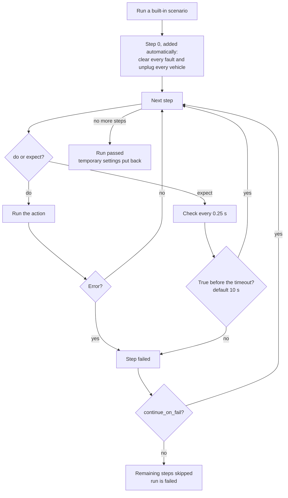

# 6. Scenarios

[Guide index](README.md) · previous: [Message rules](05-message-rules.md) · next: [How the charger answers your CSMS](07-csms-commands.md)

A **scenario** is a scripted test case. It drives the charger (plug in, tap a card, inject a fault), then **checks** what happened, and ends with a clear **passed** or **failed**,
step by step. Volkai has [35 built-in scenarios](reference/scenarios.md), and you can write your own as JSON.

## 6.1 What a scenario is

**What it is.** A list of **steps**. Each step either **does** something or **expects** something:

| Kind | What it does | Example |
|---|---|---|
| `do` | Acts on the charger | `{"do": "tap"}`, `{"do": "inject", "fault": "power_loss"}` |
| `expect` | **Waits** until a condition is true, or fails after a timeout | `{"expect": "tx_state", "state": "Charging", "timeout": 20}` |

**How it works.**



- Steps run **in order**. The message checks (`message_sent`, `message_received`, `response`) only count messages **after the run started**, so an old message cannot satisfy them; the other checks look at the charger's state right now.
- A failed step stops the run (unless the step says `continue_on_fail`), the rest are marked **skipped**, and the run is **failed**.
- Only **one scenario runs per charger** at a time. **Stop** cancels a running one.
- Built-in scenarios start with an automatic clean-up so one test cannot disturb the next. **Custom scenarios do not**: add `{"do": "reset"}` as the first step.
- A scenario can change a charger setting for its own length (`config` step); it is put back at the end, even if the run is stopped.

**Try it.** Test cases tab, pick `rfid_session`, click **Run**. Each step turns from *pending* to *running* to *passed* with the time it took; a failure shows its reason.

```bash
curl -s -X POST http://localhost:8100/api/stations/$ID/scenarios/rfid_session/run
curl -s http://localhost:8100/api/stations/$ID/scenarios/runs          # progress and results, newest first
curl -s -X POST http://localhost:8100/api/stations/$ID/scenarios/stop
```

## 6.2 The step language

Every step is a JSON object. Besides `do` or `expect` it can have:

| Field | Meaning |
|---|---|
| `label` | The text shown for the step in the result |
| `timeout` | Seconds an `expect` waits (default 10) |
| `continue_on_fail` | Keep going if this step fails |
| `only` | `"2.0.1"` or `"1.6"`: run this step only on that OCPP version; on the other it is **skipped** |
| `v16` | Fields that **replace** the step's own on an OCPP 1.6 charger (set a field to `null` to remove it) |

### Actions (`do`)

| Action | Parameters | What it does |
|---|---|---|
| `connect`, `disconnect` | none | Connect / disconnect the charger |
| `plug_in` | `evse` (1), `connector` (1), `ev` (`mid`), `soc` (20), `target_soc` (100) | Plug a vehicle in |
| `unplug` | `evse` | Unplug it |
| `tap` | `evse`, `token` (`$card`, `$card2`, or a literal card), `type` (`ISO14443`) | Tap a card. No `token` means the charger's card |
| `stop` | `evse`, `reason` (`Local`), `trigger` | Stop the session |
| `set_ev` | `evse`, `ready`, `soc`, `target_soc` | Change the vehicle (pause it, set the battery level) |
| `inject` | `fault`, `scope` (EVSE number), `params` | Inject a [fault](reference/faults.md) |
| `clear` | `fault` (a fault name, or `all`) | Clear one fault or all |
| `reset` | none | Clear every fault and unplug every vehicle |
| `send` | `action`, `payload`, `validate` | Send any charger message (a sample payload if none is given) |
| `set_variable` | `component`, `variable`, `value` | Change a device model variable (2.0.1) |
| `config` | `key` (`auto_charge`, `smart_plug`, `finishing_mode`), `value` | Change a setting for this scenario only |
| `v2x` | `evse`, `mode` (`charge` / `discharge`), `power_kw` | Start or stop feeding energy back |
| `reboot` | `reason` | Reboot with a boot reason |
| `simulate` | `action`, `payload` | Run a CSMS command locally, as if the CSMS had sent it |
| `wait` | `seconds` | Pause |
| `wait_message` | `dir`, `action`, `timeout`, `where` | Wait for a message, for example for **you** to send a command from your CSMS |

### Checks (`expect`)

| Check | Parameters | True when |
|---|---|---|
| `online` | `value` (true) | The charger is connected and boot-accepted (or, with `false`, not) |
| `connector_status` | `evse`, `connector`, `status` | The connector shows that status |
| `tx_state` | `evse`, `state`: `Charging`, `SuspendedEV`, `SuspendedEVSE`, `EVConnected`, `Idle`, or `none` | The session is in that state (`none` = no session) |
| `energy_gt` | `evse`, `wh` | The session has used more than `wh` Wh |
| `export_gt` | `evse`, `wh` | The session has fed back more than `wh` Wh |
| `message_sent` | `action`, `where`, `count_gte` (1) | The charger sent at least that many matching messages since the run started |
| `message_received` | `action`, `where`, `count_gte` | The CSMS sent at least that many matching commands |
| `response` | `action`, `status` | The CSMS answered that charger message with that status |
| `send_ok` | none | The last `send` was answered without an error |
| `tap_status` | `status` | The last `tap` gave that result (`Accepted`, `Invalid`, `ReaderFailure`, ...) |
| `faulted` | `evse`, `value` (true) | The EVSE is (or is not) faulted |
| `queue_gte` | `n` | The offline queue holds at least `n` messages |
| `queue_empty` | none | The offline queue is empty |

**`where`.** Matches fields of a message with **dotted paths** in the message's own (camelCase) names; a number picks a list item. For example `{"transactionInfo.stoppedReason": "Local"}`
or `{"eventData.0.cleared": true}`. All the pairs must match.

**Cards.** `$card` and `$card2` mean the cards set on the charger (default `CARD1` and `CARD2`), so a scenario uses whatever **your** CSMS accepts ([the cards used by tests](02-sessions-and-cards.md#23-the-cards-used-by-tests)).
If a step times out because the CSMS refused the card, the failure message names the card.

**Two versions, one scenario.** Built-in scenarios run on both OCPP versions: a check such as "the CSMS received `TransactionEvent` Ended with reason `Local`" is replaced by "...received `StopTransaction` with reason `Local`" on 1.6 using `v16`, and steps that only exist on one version use `only`.

## 6.3 Write your own

**What it is.** The same steps, as JSON, in the **Test cases** tab (*Custom scenario*) or through the API.

**Example: "a frozen meter is reported".** It checks that your CSMS is told about a meter failure, on either OCPP version:

<!-- scenario-example -->
```json
[
  {"do": "reset", "label": "Start from a clean charger"},
  {"do": "set_variable", "component": "SampledDataCtrlr", "variable": "TxUpdatedInterval", "value": 2, "only": "2.0.1"},
  {"do": "plug_in", "ev": "mid", "soc": 20},
  {"do": "tap"},
  {"expect": "tx_state", "state": "Charging", "timeout": 20, "label": "The session starts"},
  {"expect": "energy_gt", "wh": 5, "timeout": 20, "label": "Energy is flowing"},
  {"do": "inject", "fault": "power_meter_failure", "scope": 1, "params": {"mode": "frozen"}},
  {"expect": "message_sent", "action": "NotifyEvent", "where": {"eventData.0.actualValue": "true"}, "timeout": 15,
   "v16": {"action": "StatusNotification", "where": {"errorCode": "PowerMeterFailure"}},
   "label": "The CSMS is told about the meter failure"},
  {"do": "wait", "seconds": 6},
  {"do": "clear", "fault": "power_meter_failure"},
  {"do": "stop"},
  {"expect": "tx_state", "state": "none", "label": "The session ended"},
  {"do": "unplug"}
]
```

Reading it: step 1 resets; step 2 makes the charger report every 2 seconds (only on 2.0.1: the 1.6 charger already reports every 10 s); steps 3-6 start a session and wait until energy flows;
step 7 injects the fault; step 8 expects the charger to have **sent** the failure report (a `NotifyEvent` on 2.0.1, a `StatusNotification` with an error code on 1.6, via `v16`);
steps 9-13 clear the fault, stop and clean up.

**Run it.**

- **UI:** Test cases tab, *Custom scenario*, paste the JSON, give it a title, **Run**. A JSON syntax problem is flagged as you type, and an unknown action or check is refused when you press Run, before anything is done.
- **API:**

```bash
curl -s -X POST http://localhost:8100/api/stations/$ID/scenarios/custom -H 'content-type: application/json' \
  -d '{"title":"Frozen meter is reported","steps":[{"do":"reset"},{"do":"plug_in"},{"do":"tap"},{"expect":"tx_state","state":"Charging","timeout":20}]}'
```

A scenario that does not run (an unknown action or check, a step with neither `do` nor `expect`) is refused with the reason, and a custom scenario can have up to 200 steps.

**An interactive scenario.** `remote_start_from_csms` waits (up to 3 minutes) for **you** to send a start, then a stop, from your CSMS dashboard or app: `wait_message` with `"dir": "in"` waits for a command to arrive. Use it to test your real mobile app end to end.

## 6.4 Reading a result

Each step ends in one of: **passed**, **failed** (with the reason), **skipped** (not applicable to this OCPP version, or an earlier step failed) or it never ran. The run ends **passed**, **failed** or **stopped**.

A failure tells you what was expected and for how long it waited:

```
Charging starts: timed out after 20s waiting for expect:tx_state evse=1, state=Charging.
The CSMS refused the card 'CARD1' (Invalid): register it in your CSMS, or set the cards this charger uses (Edit charger, 'Cards used by tests').
```

```
CSMS received Ended (Local): timed out after 30s waiting for expect:message_sent action=TransactionEvent, where={...}
```

**A scenario passing means your CSMS behaved acceptably *as far as the checks go***. Most built-in checks look at what the charger sent and what the CSMS answered, not at your CSMS's database. To verify your CSMS stored the right thing, look at its own data after the run (see [Recipes](10-recipes.md)).

## 6.5 The built-in scenarios

35 scenarios in ten groups. The [scenario reference](reference/scenarios.md) lists every step of each.

| Group | Scenarios |
|---|---|
| **Basics** | `smoke_boot`, `rfid_session`, `unknown_token`, `authorize_then_plug`, `remote_start_from_csms`, `two_sessions`, `battery_full` |
| **Metering** | `meter_failure`, `meter_frozen`, `meter_rollback`, `meter_spike`, `meter_invalid`, `meter_failure_stops_session` |
| **Power and network** | `power_loss_session`, `power_loss_idle`, `network_loss_session`, `unstable_network`, `high_latency`, `watchdog_reboot`, `clock_drift` |
| **Safety and electrical** | `emergency_stop`, `over_current`, `ground_fault`, `over_voltage`, `over_temperature`, `tamper` |
| **Hardware** | `contactor_failure`, `reader_failure` |
| **Vehicle** | `ev_comm_loss`, `cable_pulled` |
| **Smart charging** | `grid_overload` |
| **Bidirectional charging** | `v2g_discharge` |
| **Authorization** | `auto_charge`, `smart_plug_remote_start` |
| **Protocol** | `all_messages` (sends every message the charger can send, once, and checks the CSMS answers each without an error) |

`all_messages` is a good first check of a new CSMS: any message it cannot handle shows up as a failed step named after that message.

---
Previous: [Message rules](05-message-rules.md) · Next: [How the charger answers your CSMS](07-csms-commands.md)
