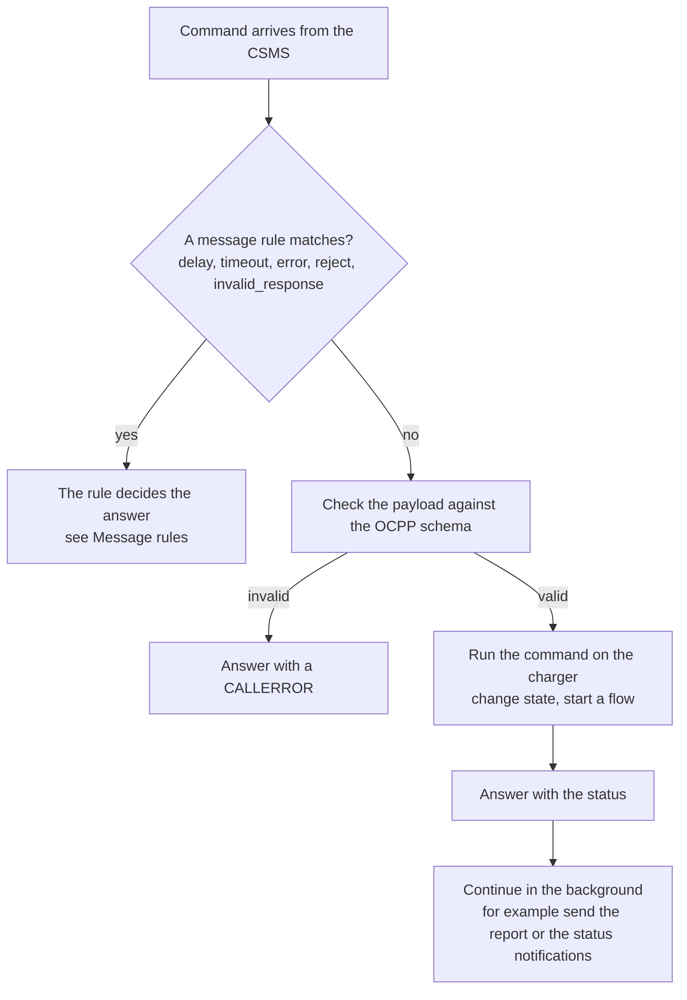
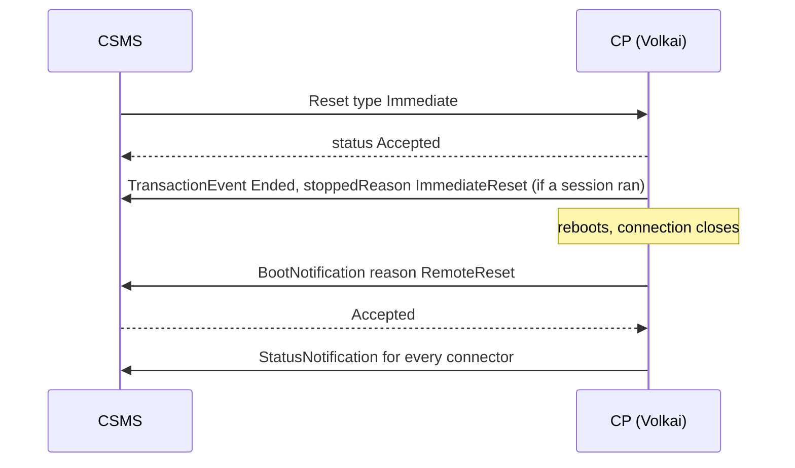
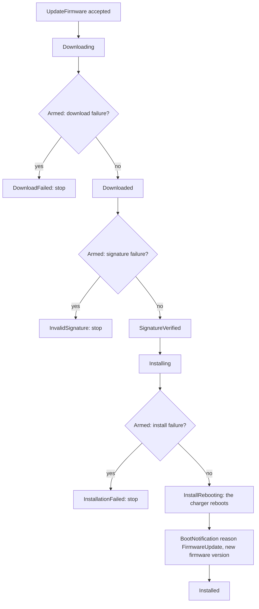
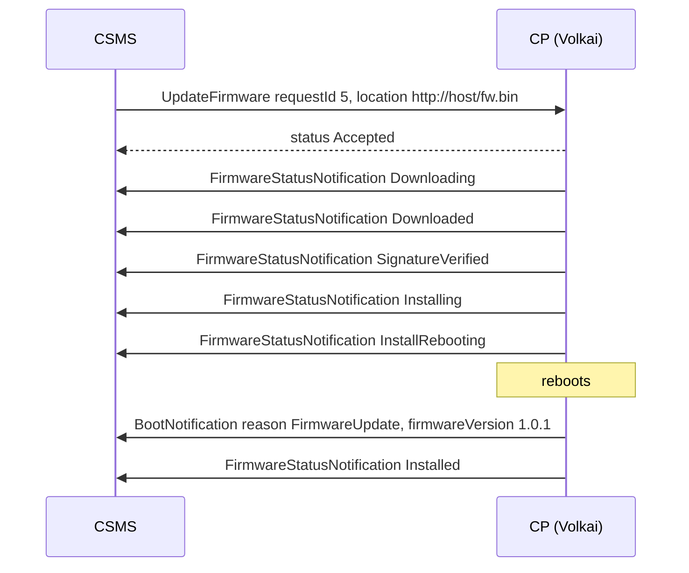
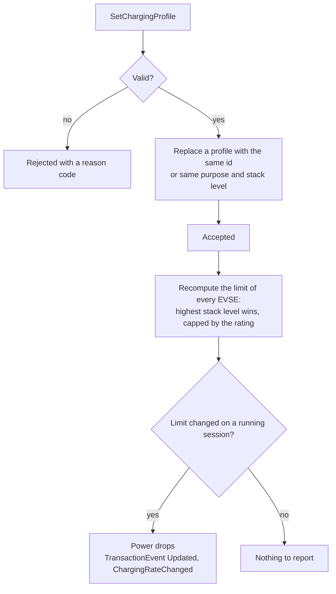

# 7. How the charger answers your CSMS

[Guide index](README.md) · previous: [Scenarios](06-scenarios.md) · next: [Tools](08-tools.md)

Your CSMS can send commands to the charger: start a session, reset it, change a setting, update its firmware. This page explains how Volkai answers each kind, so you can tell
what a correct reaction looks like. Every command and its answer are listed in the [message reference](reference/messages.md).

## 7.1 How a command is handled

**What it is.** A command is a request from the CSMS to the charger. The charger must answer it, usually with a status (`Accepted`, `Rejected`, ...), and often does more work **after** answering.

**How it works.**

The pattern *answer first, work after* matters: the charger never waits for the CSMS inside a command handler, because the CSMS may itself be waiting for this very answer.
The commands that continue after answering are marked below.

## 7.2 Remote start and remote stop

`RequestStartTransaction` / `RemoteStartTransaction` and the stop commands are explained with diagrams in [Sessions and cards: remote start](02-sessions-and-cards.md#26-remote-start-and-remote-stop-from-your-csms).
In short: the answer is `Accepted` at once if the connector is free and operative (otherwise `Rejected`), then the session starts when a vehicle is connected. `RequestStopTransaction` with a
transaction that does not exist is `Rejected`.

## 7.3 Reset, availability and unlock

| Command | Answer | What happens next |
|---|---|---|
| `Reset` Immediate (1.6: Hard / Soft) | `Accepted` | Running sessions end (reason `ImmediateReset` / `Reboot`), the charger reboots and boots again with reason `RemoteReset` |
| `Reset` OnIdle | `Scheduled` if a session is running, else `Accepted` | Waits until no session is running, then reboots |
| `Reset` for one EVSE (2.0.1) | `Accepted` / `Scheduled` | Only that EVSE goes `Unavailable` for about two seconds and comes back |
| `ChangeAvailability` Inoperative | `Accepted`, or `Scheduled` while a session runs | The station, EVSE or connector goes `Unavailable` (when the session ends, if it was busy) and a `StatusNotification` is sent |
| `ChangeAvailability` Operative | `Accepted` | The status returns to `Available` |
| `UnlockConnector` | `Unlocked`; `UnlockFailed` during a session or while the `connector_lock_failure` fault is active; `UnknownConnector` for a bad connector | The lock opens |

**Try it.** Add a message rule or just use **Simulate a command** (Messages tab) with `Reset` and `Immediate` while a session runs: the session ends and the boot reason in the log is `RemoteReset`.
For a real round trip, send `Reset` from your CSMS and watch the sequence above in the live log.

## 7.4 Trigger message

**What it is.** The CSMS asks the charger to send a message **now**: a status, a heartbeat, a meter reading, a boot.

**How it works.** The charger answers `Accepted` and then sends it. Supported on 2.0.1: `BootNotification`, `Heartbeat`, `StatusNotification`, `MeterValues`, `TransactionEvent`, `FirmwareStatusNotification`, `LogStatusNotification`,
`PublishFirmwareStatusNotification`, `SignChargingStationCertificate`. On 1.6: `BootNotification`, `Heartbeat`, `StatusNotification`, `MeterValues`, `FirmwareStatusNotification`, `DiagnosticsStatusNotification`.
Anything else is answered `NotImplemented`. A triggered boot carries the reason `Triggered`.

**Try it.** Simulate `TriggerMessage` with `StatusNotification`: one status per connector appears in the log. With `MeterValues` while a session runs: an immediate reading with context `Trigger`.

## 7.5 Firmware update and log upload

**What it is.** The CSMS orders a firmware update or a log upload. The charger walks through the standard status steps, so you can test how your CSMS tracks them.

**How it works.** `UpdateFirmware` is answered `Accepted` (or `Rejected` for an unsupported URL protocol, `AcceptedCanceled` when it replaced a running update), then the steps run in the background.
Arm the fault `firmware_update_failure` first to make a step fail: **stage** `download`, `signature`, `install` or `log`.

On **1.6** the steps are `Downloading`, `Downloaded`, `Installing`, `Installed` (and `DownloadFailed` / `InstallationFailed`), with no reboot. A **log upload** (`GetLog` on 2.0.1, `GetDiagnostics` on 1.6) is answered with a file name, then the charger sends
`Uploading` and `Uploaded` (or `UploadFailure` when armed) as `LogStatusNotification` / `DiagnosticsStatusNotification`. The State tab shows the firmware version and the upload status.

**Try it.** Faults tab, **Firmware / log transfer will fail**, stage `download`, Inject. Then **Simulate a command** `UpdateFirmware` (the sample works): the log shows `Downloading` then `DownloadFailed`. Clear the fault and run it again to see the full flow end with the reboot and `Installed`.

## 7.6 Local authorization list and cache

**What it is.** A list of cards the charger can approve **by itself**, even when the CSMS is unreachable.

**How it works.** `SendLocalList` with update type `Full` replaces the list; `Differential` changes entries and needs a higher version number (otherwise `VersionMismatch`). `GetLocalListVersion` returns the version. A card in the list is used for authorization as described in
[Cards and authorization](02-sessions-and-cards.md#22-cards-and-authorization). `ClearCache` empties the cache of cards the CSMS accepted earlier. You can also edit the list by hand in the **State** tab (each change raises the version).

## 7.7 Charging profiles and power limits

**What it is.** The CSMS limits how much power the charger may deliver, now or on a schedule: a *charging profile*.

**How it works.** `SetChargingProfile` is checked first. It is refused with a reason if the EVSE does not exist, the schedule is empty, the first period does not start at 0, periods are not in increasing order, a limit is negative, the stack level is out of range, or a `TxProfile` points to a transaction that is not running.
An accepted profile replaces one with the same id (or the same purpose and stack level on that EVSE) and takes effect **at once**: the EVSE's power limit drops, the vehicle charges slower, and a running 2.0.1 session sends a `TransactionEvent` `Updated` with trigger `ChargingRateChanged`.
When several profiles apply, the **highest stack level** wins, and the result is never above the EVSE's own rating. `GetCompositeSchedule` returns the combined schedule over a time window, `GetChargingProfiles` reports the installed ones, `ClearChargingProfile` removes them.

**Try it.** Start a charge at 22 kW. **Simulate a command** `SetChargingProfile` with a 3000 W limit (change the `limit` in the sample): the *Limit* box shows 3.0 kW, *Power* follows within a second, and the log shows the answer `Accepted`
and (2.0.1) the `ChargingRateChanged` update. Then `ClearChargingProfile`: the limit returns to 22 kW. The State tab (*Charging profiles*) lists what is installed.

## 7.8 Device model and configuration keys

**What it is.** The settings of the charger that the CSMS can read and change.

**How it works.** On **2.0.1**, `GetVariables` reads variables and `SetVariables` writes them: it answers `Accepted`, `RebootRequired`, `Rejected`, `UnknownComponent`, `UnknownVariable` or `NotSupportedAttributeType` per item, and a bad value is rejected. `GetBaseReport` / `GetReport` answer `Accepted` and then send the model as `NotifyReport`, in chunks of `ItemsPerMessage`.
On **1.6**, `GetConfiguration` and `ChangeConfiguration` do the same with keys (a read-only key gives `Rejected`, an unknown key `NotSupported`).
**Changes apply at once**: set the heartbeat interval, the sample interval, the transaction start points or the authorization switches and the charger changes behaviour immediately. The full list is in the [settings reference](reference/settings.md), and you can edit the writable ones in the **Device model** tab.

**Try it.** Simulate `SetVariables` (sample, edit the value) or use the tab directly: set `OCPPCommCtrlr.HeartbeatInterval` to 5 and see the heartbeat chip in the header change and the heartbeats speed up.

## 7.9 Reservations, data transfer and the rest

- **Reservations:** [Sessions and cards: reservations](02-sessions-and-cards.md#210-reservations).
- **DataTransfer:** vendor id `com.simulator.echo` answers `Accepted` and echoes your data; `com.simulator.reject` answers `Rejected`; any other vendor is `UnknownVendorId`.
- **Display messages, monitoring, certificates, customer information (2.0.1):** stored and answered as the standard describes (display messages show on the station display, a monitor that trips sends a `NotifyEvent`). See the [message reference](reference/messages.md) for each.

---
Previous: [Scenarios](06-scenarios.md) · Next: [Tools](08-tools.md)
