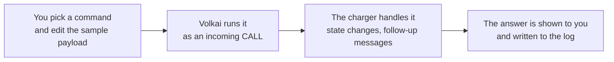
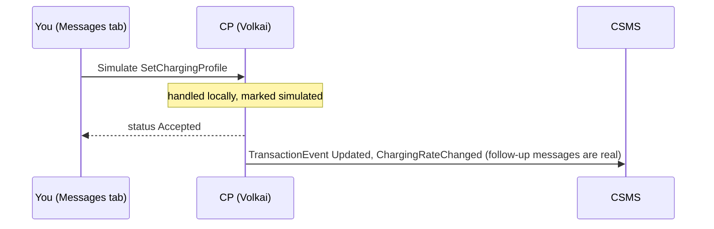
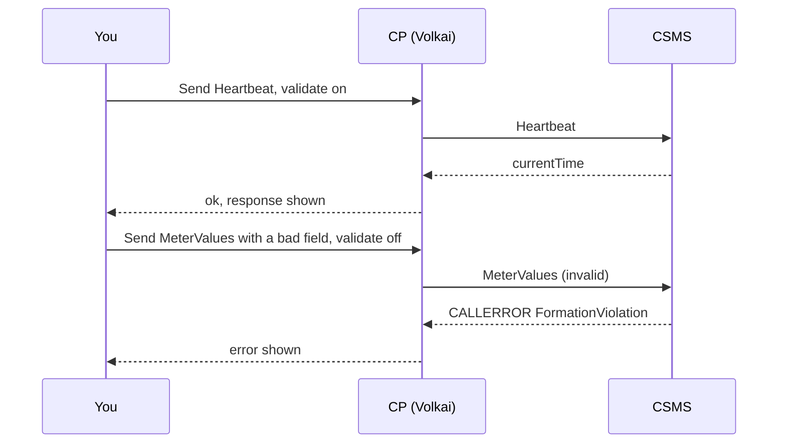

# 8. Tools: the UI, sending, simulating and the log

[Guide index](README.md) · previous: [How the charger answers your CSMS](07-csms-commands.md) · next: [API cheat sheet](09-api-cheatsheet.md)

The hands-on tools that are not faults or scenarios: the six tabs, sending any message, running a CSMS command without a CSMS, sending raw frames, and reading the log.

## 8.1 The six tabs

| Tab | What it is for |
|---|---|
| **Connectors** | Plug a vehicle in, tap a card, stop, pause the vehicle, discharge (V2G), set the meter register. One card per EVSE showing status, power, limit, energy, SoC and gun temperature |
| **Test cases** | Run the [built-in scenarios](06-scenarios.md) or your own JSON; see each step pass or fail |
| **Faults** | [Inject and clear faults](04-faults-and-injection.md) |
| **Messages** | Send a message, [message rules](05-message-rules.md), simulate a CSMS command, send a raw frame (this page) |
| **Device model** (1.6: **Configuration keys**) | Read and change the charger's settings, the same ones your CSMS can change |
| **State** | What the charger is holding: display, local list, charging profiles, reservations, offline queue, authorization cache, certificates, monitors, firmware and log status |

Below the tabs, the **live log** shows every message in both directions. Click a line to see the raw JSON.

## 8.2 Simulate a CSMS command

**What it is.** Run a command **on the charger** exactly as if your CSMS had sent it, with no CSMS involved. Use it to try a command you cannot send yet, or to repeat one quickly. The log marks it `simulated here`.

**How it works.**





Only the **command** is simulated. Anything the charger sends because of it (status notifications, meter reports, a reboot and a new boot) is **real** and goes to the connected CSMS.

**Try it.** Messages tab, *Simulate a command from the CSMS*, pick `RequestStartTransaction` (1.6: `RemoteStartTransaction`), keep the sample, **Run**. Plug in a vehicle: the session starts with the remote-start card.

```bash
curl -s -X POST http://localhost:8100/api/stations/$ID/inject -H 'content-type: application/json' \
  -d '{"action":"Reset","payload":{"type":"Immediate"}}'
```

The reply is the charger's answer to the command. The sample payload of every command is available from the API too:
`GET /api/stations/$ID/templates/Reset?kind=command`.

## 8.3 Send a message to the CSMS

**What it is.** Make the charger send any message it can send, with a payload you edit.

**How it works.** Pick the message, edit the JSON (a valid sample is filled in), click **Send**. With *validate against the OCPP schema first* ticked, an invalid payload is refused before anything is sent; untick it to send a **deliberately invalid** one and watch how your CSMS reacts. The answer (or the CALLERROR) is shown and logged.



**Try it: a CSMS must reject an invalid message.** Send `Authorize` with an `idTag` of 40 characters (the limit is 20 on 1.6, 36 on 2.0.1) with validation off: your CSMS must answer with a CALLERROR or a clean rejection, not crash.

```bash
curl -s -X POST http://localhost:8100/api/stations/$ID/send -H 'content-type: application/json' \
  -d '{"action":"Heartbeat","payload":{}}'
# -> {"sent": true, "ok": true, "status": null, "response": {"currentTime": "..."}, "error": null}

curl -s -X POST http://localhost:8100/api/stations/$ID/send -H 'content-type: application/json' \
  -d '{"action":"Authorize","payload":{"idToken":{"idToken":"X","type":"Bogus"}},"validate_schema":false}'
```

## 8.4 Raw frames

**What it is.** Send **exact text** on the WebSocket, with no checks at all. Use it for cases no message form can produce: broken JSON, a wrong message type number, a CALLRESULT nobody asked for, a made-up CALLERROR.

**How it works.** Messages tab, *Raw frame*: pick a template (or write your own), **Send raw**. Nothing is waited for; whatever comes back appears in the log.

```bash
# broken JSON
curl -s -X POST http://localhost:8100/api/stations/$ID/raw -H 'content-type: application/json' \
  -d '{"frame":"[2, \"x1\", \"Heartbeat\""}'
# a CALLRESULT for a message the CSMS never sent
curl -s -X POST http://localhost:8100/api/stations/$ID/raw -H 'content-type: application/json' \
  -d '{"frame":"[3, \"nobody-asked\", {}]"}'
```

A robust CSMS ignores or rejects both and **stays up**: check that the charger stays connected afterwards.

## 8.5 The live log

**What it is.** Every message between charger and CSMS, plus notes about what the simulator did (rules, faults, retries).

| Part | Meaning |
|---|---|
| Arrow | `→` charger sent, `←` charger received |
| Name and type | The message (`TransactionEvent`) and whether it is a request, an answer or an error |
| Note after the summary | `simulated here` (from Simulate a command), `rule #N: ...` (a rule changed it, for example `drop (not sent)`), `packet loss (not sent)`, `queued (offline)` (held while the link was down) |
| Click a line | Opens the raw JSON of the frame |

The log keeps the latest 5000 entries per charger in memory (not on disk) and is cleared when you remove the charger. **Export** downloads it as JSON, **Clear** empties it.

```bash
curl -s "http://localhost:8100/api/stations/$ID/log?after_id=0&limit=100"     # {"entries": [...], "last_id": N}
curl -s -o log.json http://localhost:8100/api/stations/$ID/log/export
curl -s -X DELETE http://localhost:8100/api/stations/$ID/log
```

Poll with `after_id` set to the previous `last_id` to receive only new entries. The UI itself gets live updates over a WebSocket at `/ws`.

## 8.6 Device model and configuration keys

See [7.8](07-csms-commands.md#78-device-model-and-configuration-keys) for what the settings do. In the tab you can filter, read, and edit every **read-write** entry; changes act at once and your CSMS sees them on its next read.

```bash
curl -s http://localhost:8100/api/stations/$ID/variables                      # all
curl -s -X PUT http://localhost:8100/api/stations/$ID/variables -H 'content-type: application/json' \
  -d '{"component":"OCPPCommCtrlr","variable":"HeartbeatInterval","value":"5"}'
```

On 1.6 send the key name as `variable` (the `component` is ignored). A read-only or invalid value is refused with the reason.

## 8.7 State tab

**What it is.** The inside of the charger: what your CSMS has stored on it.

| Section | Holds | Filled by |
|---|---|---|
| Station display | The message on the screen | `SetDisplayMessage`, or the default screen |
| Local authorization list | Cards the charger approves by itself | `SendLocalList`, or you (add / remove) |
| Charging profiles | Installed power limits | `SetChargingProfile` |
| Reservations | Connectors held for a card | `ReserveNow` |
| Offline queue | Session events waiting for the CSMS | a [network loss](04-faults-and-injection.md#43-network-loss-and-the-offline-queue) |
| Authorization cache | Cards the CSMS accepted | `Authorize` answers |
| Certificates, Variable monitors, Display messages, Network profiles | Security and monitoring data (2.0.1) | the matching commands |
| Firmware and logs | Version and the status of the last update or upload | [7.5](07-csms-commands.md#75-firmware-update-and-log-upload) |

**Try it.** Simulate `SetChargingProfile`, then open State: the profile is listed. Simulate `ClearChargingProfile`: the list empties.

## 8.8 Charger settings you can change

Add or edit a charger (**Add charger** or **Edit charger**): the name, the CSMS URL, the identity fields the charger reports at boot, the hardware preset, the speed-up factor, and the cards used by tests. Everything is described, with defaults, in the [settings reference](reference/settings.md). Your last chargers and CSMS addresses are remembered in this browser (nothing is stored on the server), so adding the next one takes a click.

While a charger is connected, settings that would change what it told the CSMS at boot (identity, URL, version, hardware) are locked: disconnect first.

---
Previous: [How the charger answers your CSMS](07-csms-commands.md) · Next: [API cheat sheet](09-api-cheatsheet.md)
