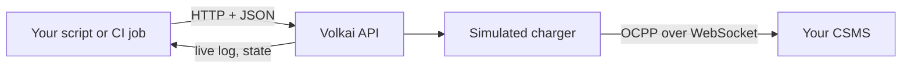
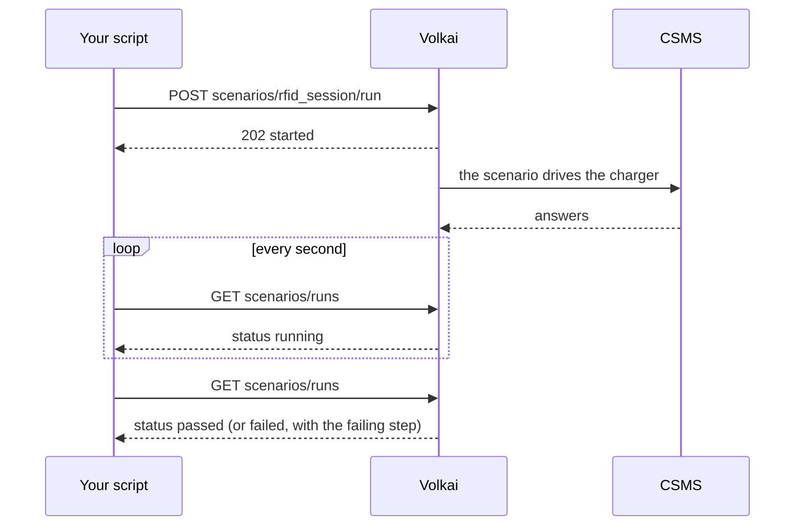

# 9. API cheat sheet

[Guide index](README.md) · previous: [Tools](08-tools.md) · next: [Recipes](10-recipes.md)

Everything the UI does is a plain HTTP call, so every test can be scripted from a shell, a CI job or your own test suite. Interactive documentation of every route is served at `/docs` (for example `http://localhost:8100/docs`).

## 9.1 Conventions

```bash
export SIM=http://localhost:8100          # where Volkai runs
export ID=<station id>                    # the "id" returned when you add a charger
```

- Bodies are JSON (`-H 'content-type: application/json'`). Wrong input gives `422` with a `detail` text; an unknown charger gives `404`.
- **Login.** If the simulator was started with `SIM_TOKEN`, send `-H "Authorization: Bearer $SIM_TOKEN"` on every call (the UI uses a cookie instead). Without `SIM_TOKEN` the API is open, which is only safe on localhost.
- Actions that need a connection (send, tap with authorization, and so on) fail with a clear message if the charger is not connected.



## 9.2 Chargers

| Call | Does |
|---|---|
| `GET /api/stations` | List all chargers with their full state |
| `POST /api/stations` | Add one (and connect, unless `"connect": false`) |
| `GET /api/stations/$ID` | One charger's state |
| `PATCH /api/stations/$ID` | Change settings (some are locked while connected) |
| `DELETE /api/stations/$ID` | Remove it |
| `POST /api/stations/$ID/connect` and `/disconnect` | Connect / disconnect |
| `POST /api/stations/$ID/reboot` | Reboot with a boot reason: `{"reason":"PowerUp"}` |

```bash
curl -s -X POST $SIM/api/stations -H 'content-type: application/json' -d '{
  "name": "Bay 1", "ocpp_id": "CP001", "csms_url": "ws://127.0.0.1:9000/ocpp",
  "ocpp_version": "auto", "preset": "ac_22_dual", "security_profile": 0,
  "card_id": "04A1B2C3", "auto_charge": false
}'
# -> {"id": "...", "version": "2.0.1", "state": "online", ...}

curl -s -X PATCH $SIM/api/stations/$ID -H 'content-type: application/json' -d '{"time_scale": 10, "card_id": "04A1B2C3"}'
```

All fields, defaults and limits: the [settings reference](reference/settings.md). `ocpp_version` is `auto`, `2.0.1` or `1.6` ([how Auto chooses](01-connect-and-versions.md)).

## 9.3 Driving a charger

| Call | Body | Does |
|---|---|---|
| `POST /api/stations/$ID/evse/1/plug-in` | `{"connector":1,"ev":"mid","soc":20,"target_soc":100}` | Plug a vehicle in |
| `POST /api/stations/$ID/evse/1/unplug` | none | Unplug |
| `POST /api/stations/$ID/evse/1/tap` | `{"token":"CARD1","type":"ISO14443"}` | Tap a card |
| `POST /api/stations/$ID/evse/1/stop` | `{"reason":"Local"}` | Stop the session |
| `POST /api/stations/$ID/evse/1/ev` | `{"ready":false}` / `{"soc":95}` / `{"target_soc":80}` | Change the vehicle |
| `POST /api/stations/$ID/evse/1/v2x` | `{"mode":"discharge","power_kw":5}` or `{"mode":"charge"}` | Feed back / charge |
| `POST /api/stations/$ID/evse/1/meter` | `{"import_kwh":5000}` and/or `{"export_kwh":0}` | Set the meter register |
| `POST /api/stations/$ID/local-list` | `{"token":"CARD9","status":"Accepted"}` | Add a card to the local list |
| `DELETE /api/stations/$ID/local-list/CARD9` | none | Remove it |

## 9.4 Faults, rules and messages

| Call | Body | Does |
|---|---|---|
| `POST /api/stations/$ID/faults` | `{"kind":"power_loss","scope":1,"params":{}}` | Inject a [fault](reference/faults.md) |
| `DELETE /api/stations/$ID/faults/7` | none | Clear fault number 7 |
| `DELETE /api/stations/$ID/faults` | none | Clear all |
| `GET /api/stations/$ID/rules` | none | List rules with hit counts |
| `POST /api/stations/$ID/rules` | `{"direction":"out","action":"Heartbeat","effect":"drop","times":1,"probability":1.0}` | Add a [rule](05-message-rules.md) |
| `DELETE /api/stations/$ID/rules/3` and `/rules` | none | Remove one / all |
| `POST /api/stations/$ID/send` | `{"action":"Heartbeat","payload":{},"validate_schema":true}` | [Send a message](08-tools.md#83-send-a-message-to-the-csms) |
| `POST /api/stations/$ID/inject` | `{"action":"Reset","payload":{"type":"Immediate"}}` | [Simulate a CSMS command](08-tools.md#82-simulate-a-csms-command) |
| `POST /api/stations/$ID/raw` | `{"frame":"[2,\"x\",\"Heartbeat\",{}]"}` | [Send a raw frame](08-tools.md#84-raw-frames) |
| `GET /api/stations/$ID/templates/{action}?kind=message\|command` | none | A valid sample payload |

```bash
curl -s -X POST $SIM/api/stations/$ID/faults -H 'content-type: application/json' -d '{"kind":"emergency_stop","scope":1}'
curl -s $SIM/api/stations/$ID | python3 -c 'import json,sys; s=json.load(sys.stdin); print(s["faults"]["active"])'
curl -s -X DELETE $SIM/api/stations/$ID/faults
```

## 9.5 Scenarios, log and settings

| Call | Does |
|---|---|
| `POST /api/stations/$ID/scenarios/{scenario_id}/run` | Start a [built-in scenario](reference/scenarios.md) (`202`) |
| `POST /api/stations/$ID/scenarios/custom` | Start your own: `{"title":"...","steps":[...]}` |
| `POST /api/stations/$ID/scenarios/stop` | Stop the running scenario |
| `GET /api/stations/$ID/scenarios/runs` | Results, newest first |
| `GET /api/scenarios/{scenario_id}` | The steps of a built-in scenario |
| `GET /api/stations/$ID/log?after_id=0&limit=500` | Log entries |
| `GET /api/stations/$ID/log/export` | The log as a JSON file |
| `DELETE /api/stations/$ID/log` | Clear the log |
| `GET /api/stations/$ID/variables` | Device model (1.6: configuration keys) |
| `PUT /api/stations/$ID/variables` | `{"component":"...","variable":"...","value":"..."}` |
| `GET /api/meta` | Everything the UI lists: presets, vehicles, faults, scenarios, messages, commands, effects |
| `GET /api/about` | Name and version |

### Run a scenario and wait for the result

A run is asynchronous: start it, then poll until its status is no longer `running`.

```bash
curl -s -X POST $SIM/api/stations/$ID/scenarios/rfid_session/run > /dev/null
while :; do
  status=$(curl -s $SIM/api/stations/$ID/scenarios/runs | python3 -c 'import json,sys; print(json.load(sys.stdin)[0]["status"])')
  [ "$status" != "running" ] && break
  sleep 1
done
echo "scenario $status"
[ "$status" = "passed" ]            # a non-zero exit code when it did not pass, for CI
```



Each run reports its `status` and its `steps`, each with `label`, `status`, `detail` (the failure reason) and `seconds`. Print the steps to see which one failed.

## 9.6 Live updates

`/ws` is a WebSocket the UI uses: it sends every charger's state and log entries as they happen. Scripts rarely need it; polling `GET /api/stations/$ID` and the log with `after_id` is enough.

---
Previous: [Tools](08-tools.md) · Next: [Recipes](10-recipes.md)
