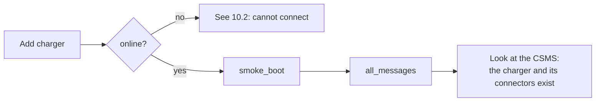
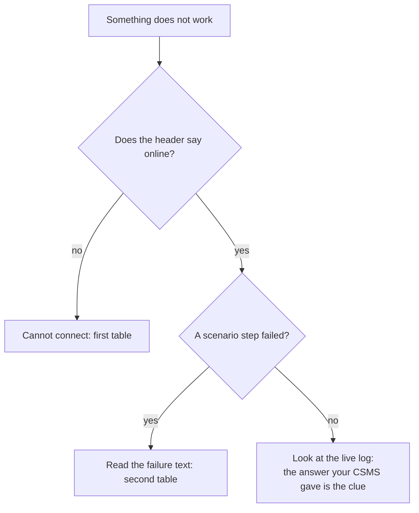

# 10. Recipes and troubleshooting

[Guide index](README.md) · previous: [API cheat sheet](09-api-cheatsheet.md)

End-to-end tests that combine the features, each with what to check in **your CSMS** afterwards, then the problems people hit most often.

> A scenario passing means the CSMS answered the way the checks expect. It does not prove your CSMS **stored** the right thing. After each recipe, look at your CSMS's own data (sessions, meter readings, costs, alerts).

## 10.1 Recipes

### Recipe 1: first connection check

1. Add a charger with your CSMS URL, version **Auto** (or the version you target), security profile matching your CSMS.
2. Check the header shows *online* and the log has `BootNotification` answered `Accepted`, then a `StatusNotification` per connector.
3. Run the scenario `smoke_boot`, then `all_messages` (every message the charger can send; a message your CSMS cannot handle shows up as a failed step named after it).



### Recipe 2: a normal session and its bill

1. Set the card the CSMS accepts in the charger settings ([cards used by tests](02-sessions-and-cards.md#23-the-cards-used-by-tests)).
2. Plug in the `mid` vehicle at 20 %, tap the card, let it charge for about a minute, click **Stop session**, unplug. (Or run `rfid_session`.)
3. In your CSMS check: one session, started and stopped once; energy equals the **difference** of the register readings (not the register itself, see [3.1](03-metering-and-v2g.md#31-two-numbers-the-register-and-the-session-energy)); a stop reason of `Local`; a cost if you use tariffs.

Speed it up: set **time scale** to `10` or more in the charger settings so a long charge takes seconds.

### Recipe 3: a billing safety check (duplicates)

1. Start a session.
2. Add the rule `out` / `TransactionEvent` (1.6: `StopTransaction`) / `duplicate` / times 1 ([5.3](05-message-rules.md#53-examples)).
3. Stop the session.
4. In your CSMS the session must be closed **once** and billed **once**.

### Recipe 4: the CSMS goes quiet during a remote start

1. Add the rule `in` / `RequestStartTransaction` (1.6: `RemoteStartTransaction`) / `timeout`.
2. Press **Start** in your CSMS app or dashboard.
3. Your CSMS must report that the charger did not respond, within its own timeout, and must not leave a pending session behind. Remove the rule afterwards.

### Recipe 5: unreliable network with a session running

1. Start a session and let it charge.
2. Inject `network_loss` for 30 seconds (see [4.3](04-faults-and-injection.md#43-network-loss-and-the-offline-queue)).
3. Check the **Offline queue** in the State tab fills, and after reconnection the CSMS receives the queued events **in order** with their original timestamps.
4. The session must still be one session with a continuous energy total.

### Recipe 6: meter faults

1. Charge, then inject `power_meter_failure` in turn with mode `frozen`, `rollback`, `spike`, `invalid` ([4.1](04-faults-and-injection.md#41-power-meter-failure)).
2. Your CSMS should notice the suspicious readings (an alert, or at least no negative or absurd energy billed). The scenarios `meter_frozen`, `meter_rollback`, `meter_spike` and `meter_invalid` do the same and check the charger's side.

### Recipe 7: power cut in the middle of a session

Run `power_loss_session`. After the power returns the charger reboots, the session must be closed (reason `PowerLoss`), and the CSMS must show it ended. Check no session stays open forever.

### Recipe 8: limit the power from the CSMS

1. Charge a `large` vehicle on `dc_150`.
2. From your CSMS (or **Simulate a command**) set a 7 kW charging profile.
3. The *Limit* box shows 7 kW and *Power* follows; the CSMS shows the lower power. Clear the profile and the power returns ([7.7](07-csms-commands.md#77-charging-profiles-and-power-limits)).

### Recipe 9: test your mobile app with a real charger flow

1. Run `remote_start_from_csms` ([6.3](06-scenarios.md#63-write-your-own)).
2. When the scenario waits, press **Start** in your app; the charger starts, charges, and the scenario waits again for **Stop**.
3. Press **Stop** in your app. The scenario passes when both commands arrived and the session ended.

### Recipe 10: run the whole suite in CI

```bash
export SIM=http://localhost:8100
ID=$(curl -s -X POST $SIM/api/stations -H 'content-type: application/json' \
  -d '{"ocpp_id":"CI001","csms_url":"ws://csms:9000/ocpp","ocpp_version":"auto","security_profile":0,"card_id":"CI-CARD-1","time_scale":10}' \
  | python3 -c 'import json,sys; print(json.load(sys.stdin)["id"])')

for sc in smoke_boot rfid_session unknown_token power_loss_session network_loss_session meter_failure; do
  curl -s -X POST $SIM/api/stations/$ID/scenarios/$sc/run > /dev/null
  while [ "$(curl -s $SIM/api/stations/$ID/scenarios/runs | python3 -c 'import json,sys; print(json.load(sys.stdin)[0]["status"])')" = running ]; do sleep 1; done
  echo "$sc: $(curl -s $SIM/api/stations/$ID/scenarios/runs | python3 -c 'import json,sys; print(json.load(sys.stdin)[0]["status"])')"
done
```

Run one scenario at a time per charger; use several chargers to run in parallel.

## 10.2 Troubleshooting



### Cannot connect

| You see | Likely cause | What to do |
|---|---|---|
| *connection refused* | The CSMS is not running or the port is wrong | Start it, check the URL. From Docker use `host.docker.internal` instead of `localhost` |
| HTTP 400 / 403 / 426 on connect | The CSMS refused the WebSocket upgrade: unsupported subprotocol, wrong identity in the URL path, or credentials | Set the version explicitly (`1.6` or `2.0.1`), check the identity, check the security profile and password |
| *boot rejected* / `Pending` | The CSMS does not know this charger id | Register the charger id in the CSMS, or use the id it expects |
| Connects, then drops after seconds | The CSMS closes the link (bad message, auth) | Open the log: the last message before the close shows why |
| Wrong OCPP version chosen | The CSMS answers with the version it prefers | Pick the version yourself ([how Auto chooses](01-connect-and-versions.md)) |

### A scenario fails

| You see | Likely cause | What to do |
|---|---|---|
| *The CSMS refused the card 'CARD1' (Invalid)* | Your CSMS does not know the default test card | Set a card your CSMS accepts: **Edit charger**, *Cards used by tests* ([2.3](02-sessions-and-cards.md#23-the-cards-used-by-tests)) |
| `timed out ... expect:tx_state state=Charging` with no card message | The vehicle was not plugged in, the connector is unavailable, or the CSMS did not answer the start | Open the log around that moment |
| `timed out ... message_sent` | The charger did not send what was expected (a message rule dropped it, or the link was down) | Clear rules and faults, run again |
| Every scenario fails at the first step | The charger is offline | Connect first |
| A scenario passes alone but fails after another | A leftover rule or setting | Remove all rules ([5.3](05-message-rules.md#53-examples)); built-in scenarios clear faults themselves, custom ones do not |
| A step is *skipped* | It does not apply to this OCPP version, or an earlier step failed | Normal; read the first failed step |

### Your CSMS shows wrong values

| You see | Likely cause | What to do |
|---|---|---|
| A session with 101 kWh in a few seconds | Your CSMS stores the meter **register** as the session energy | A CSMS bug: use the difference between start and end ([3.1](03-metering-and-v2g.md#31-two-numbers-the-register-and-the-session-energy)) |
| Two sessions after a duplicate | No idempotency | Make the CSMS ignore a repeated message id or sequence number |
| A session stays open after a power cut | The CSMS never closes sessions the charger could not end | Close or time out stale sessions |

## 10.3 Good habits

- Test with **both** OCPP versions if your CSMS supports both.
- Keep one charger per test run, give it its own id, and remove it afterwards.
- Remove rules and clear faults between experiments.
- Use a time scale of 10 or more for long charges.
- Read the live log first: it shows exactly what was sent and what your CSMS answered.

---
Previous: [API cheat sheet](09-api-cheatsheet.md) · [Guide index](README.md)
